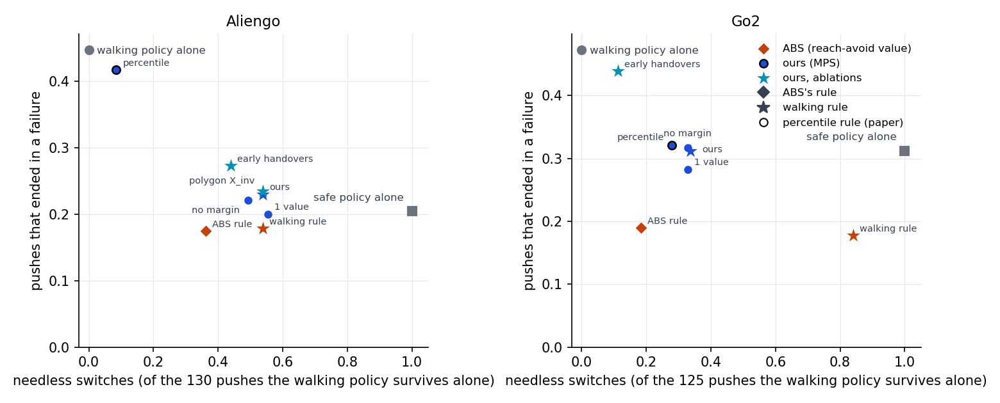
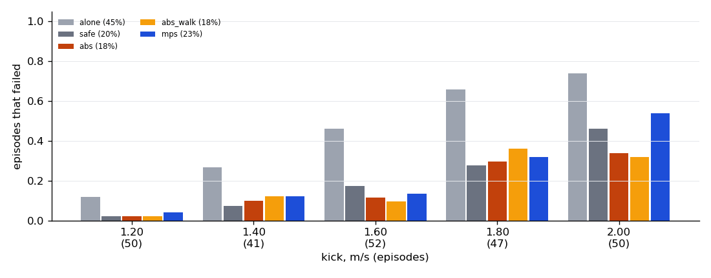
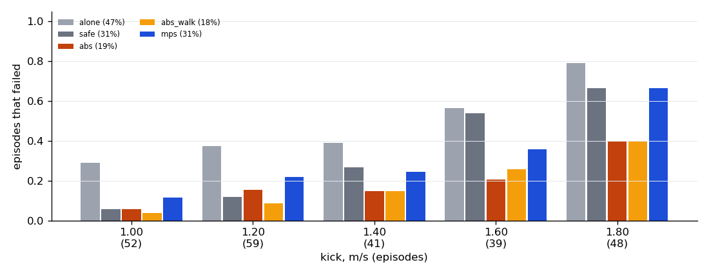
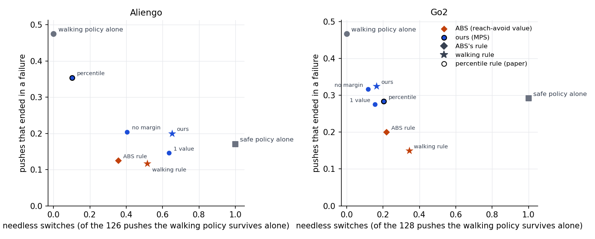

# Value function for model predictive shielding: ours (MPS) against ABS, corrected implementation

2026-11-05 · riccardobussola · Aliengo and Go2, walking and safe policies `<robot>_velocity_{normal,safe}`
(not retrained) · `robot_control` branch `feat/vf_abs_vs_mps` · every number from one run of
`run_pipeline.sh` (`report_figures/<robot>_summary.txt`, tables `report_figures/<robot>_loop_*.md`)

## Summary

The safety filter switches the robot from the walking policy to the safe policy (zero-command
recovery) when a learned value function says the robot is about to leave the safe set. This study
compares the paper's value function with the ABS baseline (He et al., RSS 2024) on the same
pushes. The first version of the study (morning of 2026-11-05) had inconsistencies in both methods;
they were fixed without changing the paper's formulation (section 1) and everything was rerun.

- **Ours (`mps`)**, the paper's: V(x) is the chance that the **safe policy**, started at x, reaches
  rest (X_inv) without leaving the safe set; TD(0) on Eq. (4). The filter walks while V ≥ threshold
  + L, and switches after 3 values in a row below it.
- **ABS (`abs`)**, now as published: the discounted reach-avoid value of the **walking policy**
  (Eq. 17 of the ABS paper): does it track its command again before leaving the safe set. The
  filter switches at V_RA ≥ −0.05, on a single value.

**Failure** (leaving the safe set, the same in the data, the training and the evaluation): a fall
(45° or base below 0.2 m), the base or a hip below 0.1 m, a knee below 3.5 cm, a joint past its
URDF position (+0.01 rad) or velocity limit. Every episode ends at its first failure.

240 pushes per robot, the same for every configuration (150–250 N on the Aliengo), the safe policy
kept once switched (the paper's protocol):

| % of the pushes that failed | Aliengo | of which speed only | Go2 | of which speed only |
|---|---|---|---|---|
| Walking policy alone | 45.4 | 27.1 | 47.3 | 0.4 |
| Safe policy alone, from the push | 20.4 | 15.8 | 31.0 | 12.6 |
| **ABS**, its rule (V_RA ≥ −0.05) | **17.5** | 14.6 | **18.8** | 11.3 |
| **Ours**, walking rule, 3 values in a row | 23.3 | 15.8 | 31.4 | 22.2 |
| Ours, walking rule, 1 value | 20.4 | 15.0 | 28.5 | 20.0 |
| Ours, the paper's percentile rule | 42.5 | 25.8 | 32.1 | 20.6 |

*Speed only: the first failure was a joint velocity past its URDF limit, with no fall, knee or
position limit; always a knee, past 15.89 rad/s (Aliengo) or 15.70 rad/s (Go2).*



*Each filter at its threshold rule, the walking policy alone and the safe policy alone. Lower left is
better: fewer failures for fewer needless switches (switches in pushes the walking policy survives
alone).*

- **Every filter halves the failures** of the walking policy (McNemar p < 1e-8), and the Go2 safe
  policy saves the robot better than the walking policy (31 % against 47 %, p = 5e-5): no policy was
  retrained.
- **ABS has the fewest failures on both robots.** Against ours: Aliengo 17.5 % vs 23.3 % (p = 0.03),
  Go2 18.8 % vs 31.4 % (p = 2e-5). Ours is as safe as the safe policy alone (Aliengo 23.3 vs 20.4,
  p = 0.31; Go2 31.4 vs 31.0, p = 1) while handing over in only a third to a half of the pushes the
  walking policy survives.
- **Most failures are knee speed overshoots, right after the handover.** In Gazebo both robots'
  safe policies, taking over a pushed robot, drive a knee past its velocity limit a median 0.13 s
  after the switch (0.07–0.16 s); the Go2 walking policy alone almost never does (0.4 %). Gazebo
  does not saturate the motors' speed; on the robot the motor would. **Without these speed-only
  failures, ours equals ABS on the Go2** (9.2 % vs 7.5 %, p = 0.48) and halves the safe policy alone
  (18.4 %, p = 0.001); on the Aliengo ABS stays ahead (2.9 % vs 7.5 %, p = 0.003), and ours on a
  single value is close (5.4 %, p = 0.11). Section 6.
- **The threshold rule matters most.** The paper's percentile rule lands at 0.03 on the Aliengo (42.5 %
  failures, as bad as no filter); the walking rule (never switch on undisturbed walking) works on both.
- **What the fixes changed.** Under the corrected safe set the comparison is the paper's Table I
  metric; the first study's headline (Aliengo falls 39 % → 5 %) counted the fall rule only, and its
  own "total failures" column already gave 48.5 % → 22.3 %. On the Go2 the walking-rule threshold of
  ours went from 0.44 to 0.85 once single-sample dips were ignored (section 1).
- **Deployed:** the filter now loads ABS on both robots (`VF_abs_<robot>`, `DEFAULT_MODEL` in
  `value_function_manager.py`); ours runs with `--filter-model`.

## 1. What changed since the first study

The first comparison (commits up to `297857e`) had the right pipeline but some wrong pieces. They
were fixed without changing the paper's formulation.

| | Before | Now | Why |
|---|---|---|---|
| ABS baseline | V trained on the walking policy with our Eq. (4) labels and a 10-sample "horizon" before a fall (an approximation, plus a variant without it) | ABS as published (Eq. 17): discounted reach-avoid value, γ = 0.999999; failure margin ζ = ±1, softened to −0.8 … 1.0 over the 10 states before a failure; target margin l = tanh(log(e/σ)), e the walking policy's tracking error, σ = 0.2 m/s; last state terminal; switch at V_RA ≥ −0.05 on a single value | the baseline has to be the published method; the 10-sample split imitated ABS's ζ softening without the reach-avoid equation or a target |
| ABS data | from the push end; episodes ended at a "capture" (capture point within 5 cm of the base) | the walking policy's whole rollout from 1 s; episodes end at a failure or 3 s after the push | ABS rolls out its agile policy whole; the capture label was a speed check, not capturability |
| Safe set (I_fall) | the fall rule only (45°, base below 0.2 m); knees and joint limits only counted in the evaluation | the fall rule, the base or a hip below 0.1 m, a knee below 3.5 cm, a joint past its URDF limit (position + 0.01 rad, velocity); the episode ends at the first | the paper's X_safe excludes knees and joint limits, and its Table I counts them as failures: the labels now match what the evaluation counts |
| X_inv (I_CP) | trunk and joint velocities below 0.1, averaged over 0.2 s | the robot on its four feet, under 10° of tilt, above 0.75 × its standing height, still (averaged over 0.5 s), held 0.3 s | velocities alone accept a robot lying still on its knees; the hold approximates invariance |
| Handovers in our data | 0–0.5 s after the push end; 20 % during undisturbed walking; timeout 6 s | 0–0.5 s after the push end; 30 % during undisturbed walking; timeout 8 s (stricter X_inv takes longer) | handing over from the push start was tried and made worse (section 5, ablation) |
| Margin L (Eq. 5) | states 0.01 s apart | states h apart, h the time from the first value below the level to the safe policy acting: 2 more evaluations + one policy step + actuator delay = 0.05 s | V must stay safe until the backup actually acts |
| Threshold (walking rule) | the lowest V over the walking states; switch on 1 value | switch after 3 values in a row; threshold from the lowest of the largest of 3 consecutive values | on the Go2, single-sample dips (lowest 0.72, 99.9 % of walking states above 0.92) set the threshold at 0.44; with 3 in a row it is 0.85. The "weak Go2 safe policy" was this artefact: the safe policy never failed taking over from walking (0 of 163) |
| Controller | V ignored for 1 s after handing back (the paper's robot setup) | V checked all the time | ignoring V leaves the walking policy unshielded; the 2 s of V above the level before handing back already prevent chattering |
| Evaluation | falls by the fall rule, other failures reported apart | failures = leaving the safe set; the first failure ends the episode and is reported by kind, with "speed only" | consistency with the training labels and with Table I |

Unchanged: the paper's TD target (Eq. 4) for our value function, the network, the training, the
walking and safe policies (no retraining), the push protocol and the torque noise.

## 2. Implementation challenges

- **Getting the robot to "rest" in simulation.** The paper's X_inv (velocities below 0.1) is never met
  at an instant: the safe policy keeps correcting and the torque noise shakes the joints (the
  fastest joint at 0.1–0.3 rad/s). Averages over 0.2 s were at the edge once a 0.3 s hold was
  required; 0.5 s separates "still" from "moving". The safe policy now reaches X_inv a median 2.7 s
  after the switch (90th percentile 5.3–5.9 s), and 11 (Aliengo) and 22 (Go2) of about 450 episodes
  time out at 8 s (left out of the training, as they have no target). With the old white torque
  noise (10 Nm per 2 ms tick) the robot never came to rest at all.
- **The threshold.** The paper's percentile rule depends on the share of failing states in the data
  and landed between 0.03 and 0.63 for our models (below zero on ABS's score); on the Aliengo it
  makes the filter useless. The
  walking rule is what made the filters work, and it has to ignore single-sample dips of V, or a few
  outlier states decide it (the Go2).
- **Where the value function is valid.** V is only accurate on states its data started the safe
  policy from, and the filter queries it everywhere. Handing over during the push looks like the fix,
  but the push's onset is not in the state: walking states then get the outcomes of pushes that have
  just started, V on walking drops (Go2: lowest walking V 0.03, margin 0.81), and the filter is
  worse (Go2 43.5 % against 31.4 %).
- **ABS's target for push recovery.** ABS's target is reaching a goal position; for a velocity-tracking
  walking policy the analogue is tracking the command again, which needs the tracking error smoothed
  over the gait (0.5 s), a scale σ (0.2 m/s), and the score −V_RA exported with the same "above the
  threshold walks" convention as ours.
- **Consistent failure labels.** Knee contact and joint limits as failures need the knee and hip
  heights from the robot's kinematics at the filter's rate, the URDF limits per joint, and an episode
  that ends at its first failure, in the data and in the evaluation alike.
- **Simulated actuators.** Gazebo does not enforce the URDF velocity limits; a recovering policy drives
  the knees past them, which a real motor could not. Once joint limits are in the safe set, this
  decides most of the comparison (section 6).
- **Statistics.** Every configuration runs the same 240 pushes (paired by seed), and arms are compared
  episode by episode (McNemar); with one Gazebo instance per container in real time, an arm takes
  about 8 minutes, the whole study about 6 h per robot.

## 3. Pipeline

`run_pipeline.sh`, per robot, in Gazebo in real time:

- **Episodes.** Reset standing still, a command uniform in ±0.5, one push 2–3 s after the start: a
  force of mass × kick / 0.2 s on the trunk for 0.2 s, the kick uniform in 0–3 m/s (Aliengo) or
  0–2.5 m/s (Go2), the direction uniform. Torque noise: an Ornstein-Uhlenbeck process per joint, std
  4 % of the torque limit, time constant 0.05 s.
- **Data.** Per method 420 training episodes (70 held out for early stopping) and 140 test episodes.
  ABS: 560 rollouts of the walking policy (Aliengo 254 failed, Go2 220). Ours: 440 (Aliengo) and 487
  (Go2) kept after the episodes that failed before the handover; 149 and 163 of them hand over during
  undisturbed walking, none of which failed.
- **Calibration runs**, the walking policy alone, every state at 100 Hz: 80 episodes of 20 s with one
  push (11 min of undisturbed walking) for the threshold, 240 with light pushes for L.
- **Closed loop.** 240 pushes per configuration, paired by seed: kicks 1.2–2.0 m/s on the Aliengo
  (150–250 N, the paper's range) and 1.0–1.8 m/s on the Go2, 5 magnitudes, random direction and time;
  7 s per episode; the filter at 100 Hz from 1 s; the safe policy kept for the rest of the episode.
  An episode whose loop missed control ticks is left out of every arm (235–240 kept).

## 4. Offline evaluation and calibration

| | AUC 0.2 s after the push | threshold (+ L) | rule | lowest V on walking (1 value / 3 in a row) | percentile rule |
|---|---|---|---|---|---|
| Aliengo ABS (score −V_RA) | 0.970 | 0.05 | ABS | 0.60 / 0.68 | −0.87 |
| Aliengo ours | 0.882 | 0.986 + 0.004 | walking, 3 | 0.988 / 0.991 | 0.03 |
| Aliengo ours, early handovers | 0.994 | 0.333 + 0.162 | walking, 3 | 0.42 / 0.49 | 0.08 |
| Aliengo ours, capture-point X_inv | 0.979 | 0.960 + 0.009 | walking, 3 | 0.953 / 0.969 | 0.18 |
| Go2 ABS (score −V_RA) | 0.977 | 0.05 | ABS | 0.76 / 0.77 | −0.22 |
| Go2 ours | 0.990 | 0.850 + 0.040 | walking, 3 | 0.72 / 0.89 | 0.63 |
| Go2 ours, early handovers | – | −0.779 + 0.807 | walking, 3 | −0.01 / 0.03 | 0.10 |

ABS is scored against the walking policy's outcome, ours against the safe policy's, so the AUCs are
not comparable across methods; the closed loop is. Ours is well calibrated (Go2: V 0.9–1.0 0.3 s
after the push → 98 % recovered, V below 0.2 → 6 %; Brier 0.002). ABS uses no margin; for ours L is
small (0.004–0.04), except for the early-handover models, whose V moves fast on walking states.

## 5. Closed loop

All in % of the episodes (needless: of those the walking policy alone survived; stopped: of those
the filter switched in, the robot brought to rest). Paired McNemar tests in
`report_figures/<robot>_loop_<table>.md`.

**Main**

| | Aliengo failed | speed only | switched | needless | stopped | switch s | Go2 failed | speed only | switched | needless | stopped | switch s |
|---|---|---|---|---|---|---|---|---|---|---|---|---|
| Walking alone | 45.4 | 27.1 | – | – | – | – | 47.3 | 0.4 | – | – | – | – |
| Safe alone | 20.4 | 15.8 | 100 | 100 | 62 | – | 31.0 | 12.6 | 100 | 100 | 49 | – |
| ABS, its rule | 17.5 | 14.6 | 63 | 36 | 51 | 0.20 | 18.8 | 11.3 | 56 | 18 | 48 | 0.21 |
| ABS, walking rule (3 in a row) | 18.3 | 15.0 | 74 | 53 | 57 | 0.16 | 17.6 | 6.7 | 91 | 83 | 60 | 0.15 |
| Ours | 23.3 | 15.8 | 73 | 54 | 56 | 0.25 | 31.4 | 22.2 | 63 | 33 | 35 | 0.24 |

Switch s: the filter's median switch time after the push start (the push lasts 0.2 s). Switches
during undisturbed walking: 0–1.3 % of the episodes. The walking rule puts ABS's threshold at 0.68
(Aliengo) and 0.77 (Go2) on its score instead of 0.05: it switches earlier (0.15 s) and far more
needlessly (Go2 83 %), for the same failures.

**Ablations of ours** (failures, p against ours with the same episodes):

| | Aliengo | p | Go2 | p |
|---|---|---|---|---|
| Ours (walking rule, 3 values in a row, margin L) | 23.3 | – | 31.4 | – |
| Switch on 1 value (threshold from the single lowest walking V) | 20.4 | 0.27 | 28.5 | 0.28 |
| No margin (L = 0) | 22.1 | 0.71 | 31.8 | 1.0 |
| The paper's percentile rule | 42.5 | 1e-10 | 32.1 | 0.86 |
| Early handovers in the data (0–0.7 s from the push start) | 27.2 | 0.16 | 43.5 | 4e-5 |
| X_inv: capture point in the support polygon | 23.4 | 1.0 | – | – |
| Switching back after 2 s above the level (the controllers) | 23.8 | – | 32.2 | – |

Switching back costs ABS 4 points (Aliengo 17.5 → 21.7, Go2 18.8 → 22.2) and ours about 1, and
halves the robots at rest at the end, as they walk again. The margin and the 3-value rule make no
significant difference: with the threshold from the walking rule, the filter switches a median
0.03–0.06 s after the push ends either way.




## 6. Knee speed limits: where the failures come from

Every speed-only failure of a filter comes after its switch: a median 0.13 s later on the Go2 and
0.12–0.20 s on the Aliengo, while the robot still carries the push's momentum. In our training data
the same happens to 10–16 % of the pushed handovers, and never on a handover during walking. The
Go2 walking policy alone almost never overshoots (0.4 %); the Aliengo walking policy does (27 %).

| % failed, all / without speed-only | Aliengo | Go2 |
|---|---|---|
| Walking alone | 45.4 / 18.3 | 47.3 / 46.9 |
| Safe alone | 20.4 / 4.6 | 31.0 / 18.4 |
| ABS | 17.5 / 2.9 | 18.8 / 7.5 |
| Ours | 23.3 / 7.5 | 31.4 / 9.2 |
| Ours, 1 value | 20.4 / 5.4 | 28.5 / 8.4 |

The "without" column is a lower bound: those episodes ended at the overshoot, and some would have
failed later. On the Go2 ours hands over in more pushes than ABS (63 % against 56 %) and in more of
those the walking policy would have survived (33 % against 18 %); each handover of a pushed robot
risks an overshoot, so ours collects twice as many (22 % against 11 %). Without them ours equals ABS
(p = 0.48).

Gazebo integrates the commanded torques with no speed limit; a real motor's torque falls to zero at
its maximum speed. Whether the overshoots are failures on the robot depends on that, and they
dominate the comparison. Options, from cheapest:

1. Report both columns (as here) and state that the velocity limits are those of the URDF.
2. Model the motors' torque-speed curve in Gazebo (the ros_impedance_controller), so overshoots
   cannot happen and the policies face the real limit.
3. Retrain the safe policies with a joint-speed penalty or limit (the Go2's in particular).

### 6.1 With the motors' torque-speed curve (option 2)

The policies were trained in Isaac Lab with a DC-motor model: each joint's torque limited to
effort × (1 ∓ qd / velocity limit), full torque at standstill and none at the velocity limit
(`saturation_effort = effort_limit`, the URDF limits). Gazebo applied the commanded torque at any
speed. The robot descriptions now carry this curve as an option (`<safety_controller>` per leg joint,
applied by gazebo_ros_control's soft limits, on with `LOCOSIM_MOTOR_SPEED_LIMIT=true` or
`saferl_controller_dataset.py --motor-limit`, off by default and never on the real robot);
`STAGES=motor run_pipeline.sh` reruns the walking policy, the safe policy, ABS and ours on the same
pushes, with the same models and calibration (`report_figures/<robot>_loop_motor.md`).

| % failed | Aliengo, no curve | Aliengo, curve | Go2, no curve | Go2, curve |
|---|---|---|---|---|
| Walking alone | 48.2 | 50.0 | 48.4 | 46.8 |
| Safe alone | 22.0 | 18.5 | 36.1 | 32.7 |
| ABS | 19.0 | **14.3** | 22.6 | **21.2** |
| Ours | 24.4 | **14.3** | 32.3 | 27.6 |
| Ours vs ABS, McNemar p | 0.11 | 1.0 | 0.008 | 0.05 |

Paired episodes only: 168 (Aliengo) and 155–156 (Go2) of the 240 pushes ran without missed control
ticks in every arm (an Isaac Lab training shared the machine during this run).

- The speed-only failures disappear (0–2 %), as they must.
- **Aliengo: ours equals ABS** (14.3 % both, 11 episodes failed only with each), both better than
  the safe policy alone (18.5 %).
- **Go2: ABS stays ahead** (21.2 % against 27.6 %, p = 0.05). The overshoots there partly turn into
  falls and knee contacts: without the extra speed the safe policy loses some of the pushes it
  recovered from (falls by the rule, ours 3.9 → 17.9 %).
- The value functions were trained and calibrated without the curve; retraining them, and the safe
  policy where it needed the speed (Go2), on the corrected Gazebo is the next step.

### 6.2 The whole study again with the motor curve

Everything rerun with `--motor-limit`: new data, both value functions retrained and recalibrated,
the closed loop on the same 240 pushes (`MOTOR_LIMIT=1 VFS="abs mps"`, outputs in
`value_function/observation_datasets/motor/`, `value_function/models_motor/`, `report_figures_motor/`;
no episode lost to missed ticks). The policies are unchanged.

| % failed | Aliengo | Go2 |
|---|---|---|
| Walking alone | 47.5 | 46.7 |
| Safe alone | 17.1 | 29.2 |
| **ABS**, its rule | **12.5** | **20.0** |
| ABS, walking rule | 11.7 | 15.0 |
| Ours, walking rule (3 in a row) | 20.0 (p = 0.006 vs ABS) | 32.5 (p = 2e-5) |
| Ours, 1 value | 14.6 (p = 0.5) | 27.5 (p = 0.01) |
| Ours, percentile rule | 35.4 | 28.3 |
| Ours, no margin | 20.4 | 31.7 |
| Switching back after 2 s: ABS / ours | 12.1 / 18.8 | 17.5 / 33.8 |



- **ABS is ahead on both robots.** Ours on a single value comes closest, level with ABS on the
  Aliengo (p = 0.5) but not on the Go2. Retraining with the curve did not help ours: with the
  previous value functions and the curve, ours tied ABS on the Aliengo (section 6.1).
- **Ours switches later**: a median 0.23–0.29 s after the push starts, against 0.19–0.21 s for ABS
  (the push lasts 0.2 s). Nearly every failure of both comes after the switch, but with ours more of
  them right after it (Go2: 10 % of the pushes fail within 0.15 s of the switch, ABS 3.8 %): the safe
  policy takes over a robot already too far gone. ABS asks "will the walking policy fail?", which
  becomes true during the push; ours asks "can the safe policy still save it?", which stays true
  until close to the edge, and our data has no handovers during the push to sharpen V there.
- **The Go2 threshold is set by one episode.** In 1 of the 80 calibration episodes V drops to 0.14 for
  0.1 s while walking sideways, upright and slow; the next lowest is 0.74. The walking rule puts the
  threshold at 0.136. Excluding that episode (threshold 0.735, a post-hoc check, not the method):
  28.3 %, still worse than ABS (p = 0.006). The threshold is not what decides the Go2.
- **The Go2 safe policy is the limit.** Alone it fails 29.2 % of the pushes, against 17.1 % on the
  Aliengo; a shield that relies on it, switched later, cannot match ABS there.

## 7. What this means for the paper

- With the corrected safe set the paper's own metric (Table I) favours ABS on both robots; the paper's
  claim that ours reduces falls from 39 % to 5 % no longer holds and has to go.
- Ours is as safe as its backup policy and hands over far less often; it can be no safer than the
  backup, and here the backups themselves overshoot the knee speed limits. The comparison with ABS
  is close only once those overshoots are left out (Go2).
- The walking rule should replace the percentile rule: the percentile rule makes the Aliengo filter
  useless (42.5 %).
- ABS should be described and implemented as the published reach-avoid value.
- `paper/` has the proposed text, tables and figures, marked `\Riccardo{}` in orange, and the diff.

## 8. Reproduce

```bash
cd ~/trento_lab_home/ros_ws/src/locosim/robot_control/base_controllers
components/safe_rl/run_pipeline.sh                    # both robots, about 6 h each
components/safe_rl/run_in_image.sh python3 components/safe_rl/plot_tradeoff.py
```

The datasets (`value_function/observation_datasets/<robot>/`) are not in the repository; the models
(`value_function/models/VF_{abs,mps,mps_early}_<robot>.*`, `VF_mps_polygon_aliengo.*`) and the figures
are.
