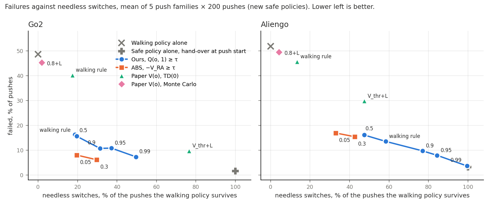
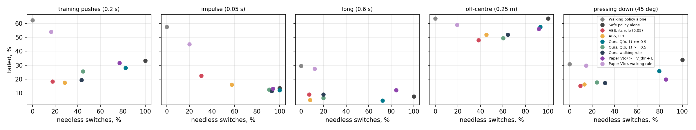
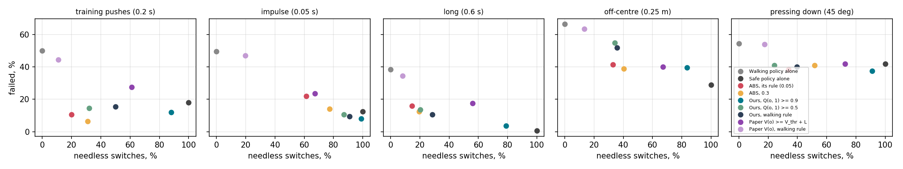
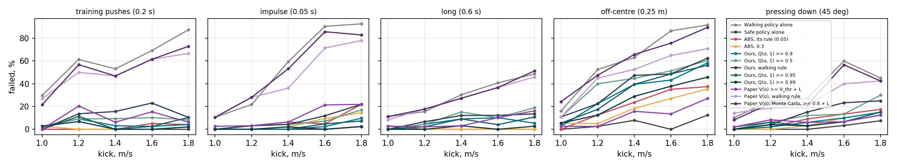
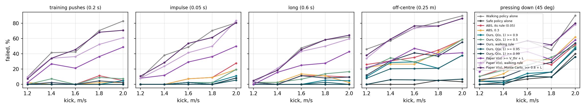

# Model Predictive Shielding with a learned value function: what we tested, what changed, what holds

2026-11-13 · Riccardo Bussola · Unitree Go2 and Aliengo, Gazebo with the motors' torque-speed curve ·
companion to the letter draft `safe_rl/paper/original/root.tex` (cited below as "the paper")

## Contents

1. [Summary](#1-summary)
2. [The paper's method, as written](#2-the-papers-method-as-written)
3. [Why it was revisited](#3-why-it-was-revisited)
4. [What we changed: the delayed-switch value Q(o, Δ)](#4-what-we-changed-the-delayed-switch-value-q-o-δ)
5. [The baselines](#5-the-baselines)
6. [The backup policy, retrained](#6-the-backup-policy-retrained)
7. [Experimental protocol](#7-experimental-protocol)
8. [Results](#8-results)
9. [Why the paper's V(o) fails as a filter](#9-why-the-papers-vo-fails-as-a-filter)
10. [What this means for the paper](#10-what-this-means-for-the-paper)
11. [Limitations and open questions](#11-limitations-and-open-questions)
12. [Reproduction](#12-reproduction)

---

## 1. Summary

The letter proposes Model Predictive Shielding (MPS) for legged locomotion. A learned value function
$V(x)$ replaces the backup-policy rollout: it estimates the probability that the backup policy
recovers from a state. The baseline is ABS (He et al., RSS 2024), whose reach-avoid value describes the
*nominal* policy instead. In our first comparison, ABS beat our value function significantly. This
document reports what we found and changed, in four steps.

1. **Diagnosis.** The original implementation broke several assumptions of the MPS argument. The value
   saw a 30-dimensional input without base velocity or history, it was queried on states it was never
   trained on (walking during a push), the switching rule was not the MPS one-step check, and the
   backup policy had never been trained on the states it is handed (§3).
2. **A reformulated value, $Q(o,\Delta)$** (§4): the probability that the backup recovers if the
   nominal policy acts for $\Delta$ more steps before the hand-over. It takes the policy's own
   228-dimensional observation as input and is trained with Monte Carlo targets on the nominal
   policy's states just before a hand-over. The rule $Q(o_k,1)\ge\tau$ is the MPS one-step check,
   learned directly. It needs neither a model to predict the next state nor a Lipschitz margin.
3. **A retrained backup policy** (§6). It is now trained with force pushes of 0.05–0.6 s, including
   off-centre and downward ones, plus a knee-contact penalty and termination. Taking over right after
   the push, it now fails on 0–5 % of the Go2 pushes and 0–13 % of the Aliengo ones, against up to
   64 % before.
4. **Closed-loop tests.** Five push families × 200 pushes per robot, with every filter facing the same
   pushes (paired by seed), and exact McNemar tests (§7–8).

**Main results (new backup, mean over the five families):**

| % of pushes failed (needless switches) | Go2 | Aliengo |
|---|---|---|
| Nominal (walking) policy alone | 48.7 (0) | 51.8 (0) |
| Backup alone, taking over at the push start (an oracle) | 1.5 (100) | 3.2 (100) |
| ABS, its rule | 8.0 (20) | 16.9 (33) |
| Ours, $Q(o,1)\ge 0.9$ | 10.7 (31) | 9.7 (77) |
| Paper's $V(o)$, TD(0), Sec. II-C threshold $V_\mathrm{thr}+L$ | 9.7 (77) | 29.8 (47) |
| Paper's $V(o)$, Monte Carlo, $0.8+L$ | 45.3 (2) | 49.5 (4) |

- **The guarantee holds; "beats ABS" does not.** With threshold τ, the probability that a hand-over
  fails is bounded by 1 − τ, if Q is calibrated (§4.4). This holds in the tests: at τ = 0.9, 5.8 % of
  the Go2's hand-overs failed. Whether ours beats ABS depends on the backup.
  - With a near-perfect backup (new Go2), ABS's implicit assumption, that the backup always
    recovers, is nearly true, and ABS is as good or better.
  - With a weaker backup (October policies, new Aliengo), ours fails less, but it pays in needless
    switches.
- **The paper's $V(o)$, in either training variant, does not work as a filter.**
  - TD(0) gives values squeezed around 0.5. The Sec. II-C threshold then lands inside normal walking
    and stops the robot before the push in 40–65 % of the episodes.
  - Monte Carlo targets give a calibrated value on hand-overs, but in closed loop it almost never
    switches.
  - The cause is the training distribution, not the target. $V$ is trained only on the backup's
    states and is queried on the nominal policy's states. On walking states that are about to fail,
    the Monte Carlo $V$ still outputs 0.97–0.99 (§9). $Q(o,\Delta)$ is trained exactly where it is
    queried.



*Each point is one filter at one threshold, averaged over 5 families × 200 pushes with the new
backup policies. Lower left is better. "Needless" means switches in pushes the nominal policy alone
survives. The Aliengo points at τ = 0.95 and 0.99 include many switches before the push (§8.3).*

---

## 2. The paper's method, as written

**Setting (Sec. II-A).** A discrete-time system $x_{t+1}=f(x_t,u_t)$, a nominal policy $\pi_n$ and a
backup policy $\pi_b$. The safe set $\mathcal X_\mathrm{safe}$ contains states with no fall and no
joint-limit violation. The control-invariant set $\mathcal X_\mathrm{inv}\subseteq\mathcal X_\mathrm{safe}$
contains static equilibria, or states whose capture point lies in a shrunk support polygon. Classic
MPS predicts $\hat x_{t+1}=f(x_t,\pi_n(x_t))$, rolls out $\pi_b$ for up to $N$ steps from it, and
applies $\pi_n$ only if that rollout reaches $\mathcal X_\mathrm{inv}$ without leaving
$\mathcal X_\mathrm{safe}$. Otherwise it applies $\pi_b$.

**Learned value (Sec. II-B).** The rollout is replaced by
$V_\varphi(x)\in[0,1]$, the probability that $\pi_b$, activated at $x$, reaches $\mathcal X_\mathrm{inv}$
without leaving $\mathcal X_\mathrm{safe}$. It is trained by TD(0) against a target network
$\varphi'$, which is updated by an exponential moving average:

$$
\mathcal L(\varphi)=\big(V_\varphi(x_t)-y_t\big)^2,\qquad
y_t=(1-\mathbb I_\mathrm{fall})\big[(1-\mathbb I_\mathrm{CP})\,V_{\varphi'}(x_{t+1})+\mathbb I_\mathrm{CP}\big].
$$

The data are transitions of $\pi_b$ after a hand-over from $\pi_n$, which had been walking under
random commands and base-velocity perturbations. **The threshold** is the value that lies below 99 % of
the $V$ values over all states of 10,000 nominal-policy simulations.

**Sensor feedback (Sec. II-C).** To avoid predicting $\hat x_{t+1}$, the paper uses Lipschitz bounds
$|V(x_t)-V(x_{t+1})|\le L_V\|x_t-x_{t+1}\|$ and $\|x_{t+1}-x_t\|\le L_f$, which give

$$
V(x_t)\ \ge\ V_\mathrm{thr}+L_VL_f\ \Longrightarrow\ V(x_{t+1})\ \ge\ V_\mathrm{thr}.
$$

$V$ is then taken on observations $o_t$, possibly with a history. $L=L_VL_f$ is estimated on 1,000
nominal-policy runs with pushes "that do not require switching", as

$$
L=\max_t\frac{|V(o_t)-V(o_{t+1})|}{\|o_t-o_{t+1}\|}\cdot\max_t\|o_t-o_{t+1}\|,
$$

after removing the top 5 % of $\|o_t-o_{t+1}\|$ and then the top 5 % of the ratio estimates.

**The positioning against ABS (Introduction).** ABS trains its value on rollouts of the nominal
policy. It therefore detects a coming failure, but "relies on the implicit assumption that the backup
policy is always able to avoid a fall". MPS trains on the backup's rollouts and so "guarantees safety
without any assumption on the backup policy".

---

## 3. Why it was revisited

In the first comparison (2026-11-05/10), ABS beat our filter significantly on both robots. On the Go2
it failed 20.0 % of the training-like pushes against our 32.5 % (p = 2·10⁻⁵). Ours also switched
*later* (0.23–0.29 s after the push started, against 0.19–0.21 s) *and* more needlessly (Aliengo: 54 %
against 36 %). It was therefore a worse classifier of the pushes, not a more permissive one. The
diagnosis (`reports/v1/mps_vs_abs_diagnosis.md`) found five broken assumptions, none of which
is a bug in the pipeline.

1. **The value function was not a function of the state.** Its input had 30 dimensions (gravity,
   angular velocity, q, q̇), with no base linear velocity, no previous action and no history. A push
   mainly changes the base velocity, so it was invisible until the legs reacted. TD(0) on such aliased
   inputs is biased: bootstrapping assumes $V(o_{t+1})$ is a valid target for $o_t$.
2. **It was queried where it had no data.** Labels started at the hand-over, one hand-over per
   episode (≈440 per robot). The filter, however, queries the value during the push, on the nominal
   policy's states.
3. **The rule was not the MPS check.** MPS certifies the predicted next state. We evaluated the
   current measurement and required 3 consecutive values below threshold, then paid the actuator
   delay. The Lipschitz margin that should cover this was estimated on light pushes and came out at
   0.004–0.04, right where $V$ changes fastest.
4. **No guarantee covers an unknown push.** MPS is a certificate for a known model. The most it can
   promise under disturbances is to keep the robot inside the backup's viability kernel. **A pure MPS
   filter cannot be safer than its backup**, while ABS can, on disturbances the nominal policy
   absorbs better than the backup.
5. **The backup had never been trained on what it is handed:** a mid-gait state, with a force still
   acting and the nominal policy's last actions in its input buffer. Taking over at the push start, it
   failed 17–34 % of the training-like pushes.

---

## 4. What we changed: the delayed-switch value $Q(o,\Delta)$

### 4.1 Input

Both value functions, ours and ABS, take **the policy's own observation**: 228 floats, the input of
the walking and safe policies. It holds the velocity command (3) and 5 frames at 50 Hz of the
accelerometer averaged over the policy step, the gyroscope, projected gravity, joint positions and
velocities relative to default, and the previous actions (5 × 45). Everything is measured on the
robot, nothing is privileged. This is the "history of past sensor measurements" that Sec. II-C
allows. The accelerometer and history make a push visible within one or two policy steps.

### 4.2 The quantity

Let $k$ index policy steps (50 Hz). Define

$$
Q(o_k,\Delta)=\Pr\Big[\text{reach }\mathcal X_\mathrm{inv}\text{ without leaving }\mathcal X_\mathrm{safe}\ \Big|\ o_k,\ \pi_n\text{ acts at }k,\dots,k+\Delta-1,\ \pi_b\text{ from }k+\Delta\Big],
\qquad \Delta\in\{0,\dots,10\}.
$$

$Q(o,0)$ is the paper's $V(o)$: hand over now. $Q(o_k,1)$ is the quantity MPS actually certifies:
*if the nominal policy acts once more, can the backup still recover from where that leaves the
robot?* The filter is

$$
\text{apply }\pi_n\text{ at }k\iff Q(o_k,1)\ge\tau,\qquad\text{else apply }\pi_b\text{ from }k\text{ on (sticky).}
$$

This is the MPS check of Sec. II-A, with the prediction $\hat x_{k+1}$ and the backup rollout folded
into a single learned probability. The decision is made at the inference tick, before the policy
network runs, so it adds no latency. It replaces both the dynamics prediction and the Lipschitz
margin of Sec. II-C. Learning $Q(\cdot,1)$ directly learns the one-step variation that $L$ tries to
bound (§9.3).

### 4.3 Data and target

**Episodes** (per robot, 1,000). The robot walks at a random command in [−0.5, 0.5]. 2–3 s in, it
receives a horizontal force of $m\,v_\mathrm{kick}/T$ for $T=0.2$ s in a random direction, with kick
$v_\mathrm{kick}\sim\mathcal U(0,2.5)$ m/s on the Go2 and $\mathcal U(0,3)$ m/s on the Aliengo. At a
random time $h$, between 0.02 and 0.7 s after the push starts, the backup takes over. 30 % of the
episodes have no push and a hand-over during normal walking. Ornstein-Uhlenbeck torque noise is
injected throughout. **The outcome** is $Y=1$ if the robot reaches $\mathcal X_\mathrm{inv}$ (static,
capture point in the polygon, held 0.3 s) and $Y=0$ if it leaves $\mathcal X_\mathrm{safe}$:
fall rule, base or hip below 0.1 m, knee below 3.5 cm, or a joint position or velocity limit.
Timeouts are left out.

**Samples.** For a hand-over at step $h$:
- every nominal-policy observation $o_s$ with $1\le h-s\le 10$ (and after the push start, since a
  push cannot be predicted before it happens) is a sample $(o_s,\Delta=h-s,Y)$;
- every backup observation is a sample $(o,0,Y)$;
- an episode that fails *before* its scheduled hand-over labels its walking observations $Y=0$ at the
  scheduled Δ. These are the "switched too late" examples.

The walking samples carry the same total weight as the backup samples. That gives about 6,000 walking
samples per robot, against about 440 hand-overs in the first study.

**Monte Carlo targets.** The network outputs $\sigma(g_\theta(o,\Delta/10))$ and is trained by
weighted binary cross-entropy against $Y$, with no bootstrapping:

$$
\mathcal L(\theta)=-\sum_i w_i\big[Y_i\log Q_\theta(o_i,\Delta_i)+(1-Y_i)\log(1-Q_\theta(o_i,\Delta_i))\big].
$$

The minimiser is $\Pr[Y=1\mid o,\Delta]$ under the data distribution, a calibrated probability. TD(0)
would only reach that if $o$ were a Markov state. Our observation is a 5-frame window, not the state
(contact phase, terrain and the push force are hidden). Bootstrapping on it is biased and, as §9
shows, compresses the values towards the initialisation.

Network: MLP 512–256–128 with LayerNorm and ELU, Adam (3·10⁻⁴), 60 epochs, 15 % of the episodes held
out, keeping the best held-out epoch. The normalisation is exported inside the ONNX graph.

### 4.4 What the rule guarantees, and what it does not

Let $k^\star$ be the first step with $Q(o_{k^\star},1)<\tau$. The last nominal action was at
$k^\star-1$, where $Q(o_{k^\star-1},1)\ge\tau$. If $Q$ is calibrated *on the distribution of
observations at which the filter stops*, then

$$
\Pr[\text{hand-over fails}\mid o_{k^\star-1}]\ \le\ 1-\tau .
$$

This is the honest form of the paper's guarantee. **The risk per hand-over is bounded by 1 − τ,
whatever the backup.** It is *not* a bound by the backup's best-case success rate. The oracle "backup
from the push start" knows when the push starts, which no filter does. The bound has two caveats:

- **Calibration under the stopping rule.** With a Markov state, a calibrated $Q$ satisfies the bound
  for any stopping rule, because the decision depends on the past only through the state. With a
  partial observation, conditioning on $o$ and on the full history differ. The 5-frame window makes
  this approximately, not exactly, true.
- **Calibration is only on the training distribution.** Four of the five test families (§7) never
  appear in $Q$'s data, so on them the bound is an empirical question.

There is also a residual case the rule cannot cover: falls where $Q$ never crosses τ. This happened on
1 of 200 Go2 training-like pushes.

### 4.5 Thresholds

- **A priori:** τ ∈ {0.5, 0.9, 0.95, 0.99}, fixed before any test.
- **The walking rule:** the 1st percentile, over the 600 nominal-policy calibration rollouts (§5.1),
  of *each rollout's lowest* $Q(o,1)$ before its push. In other words, at most 1 % of normal-walking
  rollouts would switch. The paper's per-*state* percentile ignores that the switch is permanent: an
  episode of about 350 steps then crosses a 1 %-per-state threshold with high probability.

---

## 5. The baselines

### 5.1 ABS, as implemented here

The value is ABS's discounted reach-avoid value of the **nominal** policy, Eq. 17 of He et al.:

$$
V_\mathrm{RA}(s)=\gamma\max\{\zeta(s),\min\{l(s),V_\mathrm{RA}(s')\}\}+(1-\gamma)\max\{l(s),\zeta(s)\},\qquad \gamma=0.999999 .
$$

- $\zeta=+1$ outside $\mathcal X_\mathrm{safe}$ and −1 inside, softened linearly over the last 10
  states before a failure.
- $l=\tanh(\log(e/\sigma))$ is a target margin from the command-tracking error $e$. ABS uses the goal
  distance, which has no equivalent here.
- Training is TD with an EMA target network on 600 nominal-policy rollouts (10 × 60) with the same
  training push.
- ABS switches when $V_\mathrm{RA}\ge-0.05$ (threshold 0.05 on $-V_\mathrm{RA}$). We also test 0.3.

**Differences from the published ABS:**

| | Published ABS | Here |
|---|---|---|
| Input | twist, goal and 11 ray distances, no joints, no history | the same 228-dimensional policy observation as ours (a stronger baseline) |
| Failure | collision | leaving $\mathcal X_\mathrm{safe}$ (falls, joint limits, knee contact) |
| Target margin | goal distance | command-tracking error |
| Data | 200k agile-policy episodes, Isaac | 600 episodes, Gazebo |
| Recovery | twist commands optimised through $V$; switches back | the zero-command backup policy; sticky (no switching back), as for ours |

Only the value definition and the switching rule are ABS's. Both filters get the same input, the same
robot and the same backup.

### 5.2 The paper's $V(o)$, reproduced

To separate the effect of the *target* from that of the *quantity*, the paper's $V(o)$ was trained
on the same data and input as $Q$, but only on the backup's observations from the hand-over on, in two
ways:

- **TD(0)** exactly as in Sec. II-B: target network with EMA 0.99, squared TD error on a sigmoid
  output, target 0 at a failure, 1 in $\mathcal X_\mathrm{inv}$, and $V_{\varphi'}(o_{t+1})$
  otherwise.
- **Monte Carlo:** cross-entropy against the episode's outcome on every backup observation.

The Sec. II-C rule is calibrated on the 600 calibration rollouts. The rollouts the nominal policy
survives play the "pushes that do not require switching". $V_\mathrm{thr}$ is the per-state 1st
percentile and $L$ is the formula above, with the paper's 5 % + 5 % trimming. Because the TD(0)
values are not probabilities (§8.4), the Monte Carlo version is tested at a probability fixed in
advance, $p+L$ with $p=0.8$.

---

## 6. The backup policy, retrained

The backup is the zero-command "safe" policy, trained in Isaac Lab with PPO (rsl_rl, symmetry
augmentation) and resumed from the velocity-tracking policy. The October version trained only on its
own resets plus instantaneous ±1.5 m/s velocity kicks. It was never handed a robot under a force still
acting, and when pressed it folded onto its knees: 27 % of the Go2 pressing-down pushes ended in knee
contact. We added three terms (`apply_handover()` in safe_rl `safe_env_cfg.py`):

- **A force push** (`ForcePush`). Every $\mathcal U(1,4)$ s, the base receives, for a duration
  $T\sim\mathrm{LogUniform}(0.05,0.6)$ s, a force of horizontal magnitude
  $F=m\,\Delta v/T$ with $\Delta v\sim\mathcal U(0.5,2.0)$ m/s in a random direction. That is the same
  velocity change as a kick, spread over time.
  - With probability 0.3 the force has a downward component $-u\,F$, $u\sim\mathcal U(0,1)$.
  - With probability 0.3 it acts at a lever $r\sim\mathcal U(-0.25,0.25)$ m along the body x axis,
    adding a torque $\boldsymbol\tau=\mathbf r\times\mathbf F$.
  - The force is fixed in the world frame and applied in the body frame at every step. The existing
    velocity kicks stay.
- **A knee-height penalty:** $r=-10\sum_{\text{calves}}\max(0,\,0.08-z)/0.08$.
- **A knee-contact termination:** any calf below 3.5 cm, the same threshold as the failure label in
  Gazebo.

Both robots were retrained with the same recipe, so that both backups, and so both feasible sets, are
defined the same way. The runs were stopped at about 65.5k iterations.

- **Aliengo:** the last checkpoint, `model_65300`. There were no instabilities.
- **Go2:** `model_64700`. At iteration 65131 the critic loss spiked to 2·10³ and training falls rose
  from under 1 % to about 25 %. Checkpoint 64700 comes before that collapse, and before a slow rise in
  falls that started around 64,775. It also has the run's lowest fall rate: about 0.2 % body or hip
  contacts and 2 % knee terminations, with 98 % of episodes reaching the time limit.

**The effect on the backup alone, taking over at the first inference after the push starts** (200
paired pushes per family):

| % failed | Go2, October → new | Aliengo, October → new |
|---|---|---|
| Training-like (0.2 s) | 34.0 → **0.0** | 18.0 → **0.0** |
| Impulse (0.05 s) | 13.5 → **0.5** | 12.5 → **1.5** |
| Long (0.6 s) | 7.5 → **0.0** | 0.5 → 0.0 |
| Off-centre (0.25 m lever) | 63.5 → **5.0** | 29.0 → **1.5** |
| Pressing down (45°) | 34.0 → **2.0** | 42.0 → **13.0** |

Every change is significant (exact McNemar, p ≤ 6·10⁻⁵) except the Aliengo long push. A consequence
to keep in mind: **the five test families are now inside the backup's training distribution.** They
remain outside every value function's data.

---

## 7. Experimental protocol

- **Simulator:** Gazebo in Docker, the controller at 50 Hz on the wall clock, the motors'
  torque-speed curve, and 10 containers in parallel. Episodes where the controller missed control
  ticks are discarded, and the comparison uses only pushes that every arm completed. After a rerun of
  one cell, no cell lost more than 4 of 200 episodes.
- **Push families.** 200 pushes each, kicks in {1.0, 1.2, 1.4, 1.6, 1.8} m/s on the Go2 and
  {1.2, …, 2.0} m/s on the Aliengo, with random direction and timing. Only *training* appears in the
  value functions' data.

  | Family | Duration | Force | Point of application |
  |---|---|---|---|
  | training | 0.2 s | $m\,v/0.2$ | base |
  | impulse | 0.05 s | 4× | base |
  | long | 0.6 s | ⅓× | base |
  | off-centre | 0.2 s | 1× | 0.25 m ahead of or behind the base |
  | pressing down | 0.2 s | 1× horizontal + equal downward | base |

- **Pairing.** Every arm (filter and threshold) faces the same pushes: seed = robot seed + 1000 +
  100 × family index. Differences are tested with the **exact two-sided McNemar test** on the paired
  failure indicators.
- **Metrics:**
  - *failed*: leaving $\mathcal X_\mathrm{safe}$ within 7 s;
  - *switched*: the share of pushes in which the backup took over;
  - *needless*: switches in pushes that the nominal policy alone survives;
  - *switch time*: the median switch time relative to the push start (negative means the filter
    switched before the push).
- **Reference arms:** the nominal policy alone, and the backup alone from the first inference after
  the push starts. The latter is an oracle that knows the push timing.
- **Calibration data is never test data.** Thresholds come from the 600 calibration rollouts and the
  training episodes only.

---

## 8. Results

### 8.1 With the October backup

Ours used the walking rule and ABS its own rule (% failed, 200 pushes per family):

| | Go2 ours / ABS | p | Aliengo ours / ABS | p |
|---|---|---|---|---|
| Training-like | 19.0 / 18.0 | 0.88 | 15.5 / 10.5 | 0.12 |
| Impulse | **11.5** / 22.5 | 3·10⁻⁴ | **9.5** / 22.0 | 4·10⁻⁷ |
| Long | 9.0 / 9.0 | 1 | 10.5 / 16.0 | 0.08 |
| Off-centre | 52.0 / 48.0 | 0.26 | 52.0 / **41.5** | 7·10⁻⁴ |
| Pressing down | 17.0 / 15.0 | 0.48 | 40.0 / 38.5 | 0.66 |
| 4 unseen families pooled | 22.4 / 23.6 | 0.39 | 28.0 / 29.5 | 0.31 |

The reformulation closed the gap: the first study's significant loss became a tie overall. Ours won
where the backup was strong (impulses, which it had trained on) and lost where the nominal policy
absorbed the disturbance better than the backup (Aliengo off-centre). With that backup, ours at
τ = 0.9 was not usable, because $Q(o,1)$ dipped below 0.9 during normal walking in 23 % (Go2) and 34 %
(Aliengo) of the rollouts.




### 8.2 The value functions with the new backup

New hand-over data (1,000 episodes per robot, same recipe), with all MPS-side values retrained. ABS
describes the nominal policy and is unchanged.

| | Go2 | Aliengo |
|---|---|---|
| $Q(o,1)$, held-out AUC (October → new) | 0.979 → 0.993 | 0.942 → 0.994 |
| $Q(o,1)$, mean on failed hand-overs (October → new) | 0.23 → 0.01 | 0.37 → 0.07 |
| Walking rule (October → new) | 0.53 → 0.37 | 0.67 → 0.70 |
| Normal-walking rollouts with $\min Q(o,1)<0.9$ (October → new) | 23 % → 4 % | 34 % → 8 % |
| Hand-overs during normal walking that failed | 0 of 268 | 0 of 105 |

### 8.3 Closed loop with the new backup

**% failed per family** (p: McNemar against ABS at its rule):

| | Train | Impulse | Long | Off-centre | Down | Mean | Needless (mean) |
|---|---|---|---|---|---|---|---|
| **Go2** nominal alone | 62.0 | 57.5 | 29.5 | 63.5 | 31.0 | 48.7 | 0 |
| backup alone (oracle) | 0.0 | 0.5 | 0.0 | 5.0 | 2.0 | 1.5 | 100 |
| ABS 0.05 | 2.0 | 7.5 | 0.5 | 22.5 | 7.5 | 8.0 | 20 |
| ABS 0.3 | 1.0 | 5.5 | 0.0 | 19.0 | 5.0 | **6.1** | 30 |
| ours, walking rule (0.37) | 12.5 | 8.5 | 9.0 | 39.5 | 12.0 | 16.3 | 19 |
| ours 0.9 | 4.5 | **2.5** (p .03) | 6.0 (p .003) | 34.5 (p 7e-4) | 6.0 | 10.7 | 31 |
| ours 0.95 | 5.5 | 2.5 (p .01) | 5.0 | 34.5 | 6.5 | 10.8 | 37 |
| ours 0.99 | 2.5 | **1.0** (p 1e-3) | 1.0 | 27.0 | 5.0 | 7.3 | 50 |
| **Aliengo** nominal alone | 50.0 | 49.5 | 38.5 | 66.5 | 54.5 | 51.8 | 0 |
| backup alone (oracle) | 0.0 | 1.5 | 0.0 | 1.5 | 13.0 | 3.2 | 100 |
| ABS 0.05 | 3.5 | 8.5 | 7.0 | 37.0 | 28.5 | 16.9 | 33 |
| ABS 0.3 | 1.5 | 7.0 | 6.5 | 33.0 | 29.0 | 15.4 | 43 |
| ours, walking rule (0.70) | 2.0 | 2.0 (p .002) | 6.5 | 32.5 | 24.5 | 13.5 | 58 |
| ours 0.5 | 5.0 | 4.5 | 8.5 | 34.5 | 28.0 | 16.1 | 47 |
| ours 0.9 | 1.0 | **3.0** (p .003) | **2.5** (p .04) | **24.0** (p 4e-4) | **18.0** (p 5e-5) | 9.7 | 77 |
| ours 0.95 | 0.0 | 1.5 | 0.5 | 20.0 | 17.5 | 7.9 | 84 |
| ours 0.99 † | 0.0 | 1.5 | 0.0 | 4.5 | 12.0 | 3.6 | 100 |

**Switching before the push** (share of pushes, mean over families) and the median switch time:

| | ABS 0.05 | ABS 0.3 | ours w.r. | ours 0.9 | ours 0.95 | ours 0.99 |
|---|---|---|---|---|---|---|
| Go2 | 0 %, 0.19 s | 0 %, 0.17 s | 1.7 %, 0.26 s | 4.9 %, 0.20 s | 5.5 %, 0.19 s | 13 %, 0.11 s |
| Aliengo | 0 %, 0.18 s | 0 %, 0.17 s | 1.4 %, 0.14 s | 6.8 %, 0.10 s | 12 %, 0.07 s | **53 %**, −0.30 s |

† On the Aliengo, τ = 0.99 is above the median of normal walking's lowest $Q$ (0.987). It stops the
robot before the push in half the episodes, so it is the backup at a random time, not a filter. The
same holds, to a lesser degree, for τ = 0.95 (12 %). These points are not fair comparisons.

**Reading.**

1. **The backup was the main bottleneck.** With the new backups every filter fails far less often.
   ABS's pooled failures on the four unseen families went from 23.7 % (Go2) and 29.5 % (Aliengo) to
   9.5 % and 20.2 %.
2. **The bound holds.** On the Go2 training-like pushes, 5.8 % of ours' hand-overs at τ = 0.9 failed
   (8 of 138, bound 10 %), and 11.5 % at τ = 0.5 (bound 50 %). All 8 failures at 0.9 were late
   hand-overs, 0.23–0.84 s after the push start, after $Q$ had stayed above 0.9.
3. **Go2: ABS is better.** It is better overall, and on the long and off-centre pushes in particular,
   where ours hands over later. With a backup that recovers from almost any hand-over, ABS's
   assumption is nearly true. Its early, conservative trigger (any disturbance large enough to
   threaten the nominal policy) is then close to optimal. Ours at 0.99 comes closest (7.3 %) but only
   with 50 % needless switches, while ABS at 0.3 fails 6.1 % with 30 %.
4. **Aliengo: ours fails less, but by switching more.** At τ = 0.9 it beats ABS on four of five
   families (9.7 % against 16.9 %), with 77 % needless switches against 33 %, and 7 % of its switches
   come before the push. At a matched needless rate the two are about even: ours 0.5 fails 16.1 % at
   47 %, ABS 0.3 fails 15.4 % at 43 %. What τ gives ours is a knob that reaches the low-failure end.
   ABS's threshold barely moves it (16.9 → 15.4 %).
5. **The same τ means different behaviour on the two robots.** At τ = 0.9 the Aliengo filter switches
   at almost any push, while the Go2's waits too long. A shared probability threshold is meaningful
   only if $Q$ is calibrated on walking states *during* pushes of the test kind, which neither the
   held-out AUC nor the training data checks.




### 8.4 The paper's $V(o)$

**Held-out hand-overs** (new backup):

| | TD(0), Go2 | TD(0), Aliengo | MC, Go2 | MC, Aliengo |
|---|---|---|---|---|
| AUC | 0.962 | 0.997 | 0.970 | 0.992 |
| mean V, recovered / failed | 0.51 / 0.18 | 0.45 / 0.11 | 0.985 / 0.12 | 0.976 / 0.21 |
| share of hand-overs with V in [0.4, 0.6] | 80 % (recovery rate 99 %) | 62 % (100 %) | – | – |
| recovery rate with V ≥ 0.8 | – | – | 99 % | 98 % |
| Sec. II-C: $V_\mathrm{thr}$, $L$ | 0.46, 0.10 | 0.32, 0.11 | 0.998, 2·10⁻⁴ | 0.985, 7·10⁻⁴ |

**Closed loop** (mean over families, % failed / needless / switched before the push):

| | Go2 | Aliengo |
|---|---|---|
| TD(0), $V_\mathrm{thr}+L$ | 9.7 / 77 / **65 %** (median −1.3 s) | 29.8 / 47 / **40 %** (median −1.3 s) |
| TD(0), walking rule | 40.2 / 17 / – | 45.7 / 13 / – |
| MC, $0.8+L$ | 45.3 / 2 / 0 % | 49.5 / 4 / 0 % |

- **TD(0) ranks hand-overs well but its values are not probabilities.** Most hand-overs sit at
  V ≈ 0.5 and almost all of them recover. At $V_\mathrm{thr}+L$ the threshold lands inside normal
  walking, so the filter mostly stops the robot before the push. Its Go2 failure rate (9.7 %) comes
  from standing still when the push arrives, not from detecting it. At the walking rule it barely
  reacts. This repeats the October picture, where it handed over before the push in 52–81 % of the
  episodes.
- **The Monte Carlo $V$ is calibrated on hand-overs and useless as a filter.** It switches on only
  2–12 % of the pushes and fails nearly as often as the nominal policy alone.

---

## 9. Why the paper's $V(o)$ fails as a filter

### 9.1 The diagnostic

On the held-out MPS episodes (the training split's held-out set), take the nominal-policy
observations 1–10 steps before a hand-over after a push. Label each with whether that hand-over
recovered. These are exactly the states the filter is queried on.

| AUC; mean value on recovered / failed | Go2 (983 states, 172 failed) | Aliengo (609 states, 206 failed) |
|---|---|---|
| Ours $Q(o,\Delta)$ | **0.994**; 0.98 / 0.07 | **0.964**; 0.96 / 0.19 |
| ABS $-V_\mathrm{RA}$ | 0.975; 0.85 / −0.54 | 0.965; 0.85 / −0.47 |
| Paper $V(o)$, Monte Carlo | 0.729; 0.999 / **0.974** | 0.765; 0.993 / **0.988** |
| Paper $V(o)$, TD(0) | 0.735; 0.56 / 0.50 | 0.681; 0.50 / 0.43 |

On walking states that are about to fail, the Monte Carlo $V$ outputs 0.97–0.99, and 97–100 % of them
are above 0.8. It has never seen a walking state under a push. It was trained only on the backup's
states, where "being in the backup" already correlates with recovering.

### 9.2 Interpretation

The paper's $V$ and our $Q$ differ in two independent ways:

| | What it fixes | Paper's $V$, TD(0) | Paper's $V$, MC | Ours $Q(o,\Delta)$ |
|---|---|---|---|---|
| Target: Monte Carlo instead of TD(0) | the output is a probability, so τ and the bound mean something | ✗ | ✓ | ✓ |
| Training states: the nominal policy's states before a hand-over | the value is right where the filter queries it | ✗ | ✗ | ✓ |

Both are needed. Monte Carlo is necessary for the guarantee, and training on the query distribution
is necessary for the filter to work. The earlier conclusion that "the paper's V needs Monte Carlo
targets" is correct but not sufficient.

### 9.3 Why the Lipschitz margin does not rescue it

Sec. II-C estimates $L$ on pushes "that do not require switching". There, a good value is flat:
$L_V\approx10^{-5}$ and $L\approx10^{-4}$ for the Monte Carlo $V$. The margin is measured exactly where
$V$ does not move, and comes out at about zero. The decision, however, happens where $V$ drops from 1
to 0 within a few policy steps. For the TD(0) $V$, $L\approx0.1$ is about as wide as the whole squeezed
range of values. A valid margin would have to be estimated on pushed states near the switch, where it
becomes large and conservative. $Q(o,1)$ removes the problem by learning the one-step look-ahead
itself.

The per-state percentile has a similar defect. With a permanent switch and about 350 steps per
episode, "below 99 % of the states" fires in most episodes. The quantity to calibrate is per
rollout.

---

## 10. What this means for the paper

**Original idea and current state:**

| Element | Paper | Now |
|---|---|---|
| Quantity | $V(x)$: P(backup recovers from $x$) | $Q(o,\Delta)$: P(backup recovers after Δ more nominal steps); the rule uses $\Delta=1$ |
| Check | $V(\hat x_{t+1})\ge$ thr with a model, or $V(o_t)\ge V_\mathrm{thr}+L$ | $Q(o_t,1)\ge\tau$: the one-step MPS check, learned |
| Input | state, or $o_t$ with an optional history | the policy's 228-dimensional observation, 5-frame history with accelerometer |
| Target | TD(0) with a target network | Monte Carlo cross-entropy against the episode outcome |
| Training states | backup's states after the hand-over | nominal states ≤ 10 steps before the hand-over, plus backup's states |
| Threshold | per-state 1st percentile, plus $L$ | τ fixed in advance; or per-rollout false-alarm calibration |
| Lipschitz margin | estimated on light pushes | not needed; the estimate is ≈ 0 where measured (§9.3) |
| Backup | zero-command policy, velocity kicks | plus force pushes (0.05–0.6 s, off-centre, downward) and knee terms |

**Claims that hold:**

1. **A per-hand-over risk bound for any backup:** if $Q$ is calibrated, a hand-over fails with
   probability at most $1-\tau$. This is supported in closed loop (5.8 % at τ = 0.9). It is
   "without any assumption on the backup" in the sense that the backup's weakness shows up in $Q$,
   not as a hidden failure.
2. **τ is an interpretable knob** that trades needless switches for failures, down to the backup's
   own failure rate. ABS's threshold does not reach that end.
3. **Sensor-based MPS needs no state estimate and no Lipschitz margin** when the look-ahead is learned
   ($Q(o,1)$) on the policy's observation.
4. **Where the backup is strong and the nominal policy is not, MPS beats ABS significantly.** This is
   the case for impulses on both robots with either backup, and for 4 of 5 families on the Aliengo
   with the new backup, though at more needless switches.

**Claims that do not hold:**

- **"MPS beats ABS" in general.** With a near-perfect backup ABS is as good or better (new Go2).
  Conversely, where the nominal policy absorbs a disturbance better than the backup, ABS can be safer
  than any pure MPS filter. A pure MPS filter is never safer than its backup.
- **The paper's own $V(o)$ and Sec. II-C calibration, as written.** TD(0) does not produce
  probabilities on this data. Training on the backup's states alone does not produce a filter. The
  per-state percentile and the Lipschitz estimate do not bound what they claim to.

**Suggested framing.** Present the contribution as a calibrated, backup-aware filter with an explicit
risk knob, and compare at matched needless-switch rates (the trade-off figure), not at single
thresholds. If a strict improvement over both baselines is wanted, an optimal-stopping combination of
both values is the natural extension (`reports/v1/mps_vs_abs_diagnosis.md`, §8). It would switch when the
nominal policy is about to fail (ABS) *and* when waiting would lose recoverability (ours).

---

## 11. Limitations and open questions

- **Simulation only.** Everything is in Gazebo with a motor model, and nothing yet runs on hardware.
- **The backup has seen the test families.** After retraining, the five families are in-distribution
  for the backup (not for the value functions). A disturbance family new to both is still missing,
  for example a torque about the vertical axis, terrain, or a moving load.
- **Calibration of $Q$ during pushes is not measured directly.** The held-out AUC is on hand-overs.
  The Go2/Aliengo difference at the same τ shows that calibration under the filter's own stopping
  rule needs its own test: a reliability diagram of $Q(o,1)$ at the actual switch states.
- **Pre-push switches at strict τ.** At τ ≥ 0.95, normal walking already dips below the threshold in
  some rollouts, more on the Aliengo. A larger or more diverse normal-walking set in the data would
  sharpen $Q$ there.
- **Single training run per value function, one seed.** Confidence intervals on the closed-loop rates
  come from the paired tests only. Training variance is not measured.
- **The Go2 backup checkpoint was chosen from training curves** (before a critic-loss spike), not by a
  separate validation run.
- **ABS is a re-implementation** with our input, failure definition and target margin (§5.1). The
  original agile policy, rays and goal-reaching task are not reproduced.

---

## 12. Reproduction

All paths are relative to `robot_control/base_controllers/components/safe_rl/`.

| What | Where |
|---|---|
| Value functions (Q, ABS, paper TD(0), paper MC) | `v2/train.py --method mps\|abs\|paper\|paper_mc` |
| Walking rule; Sec. II-C calibration | `v2/calibrate.py`, `v2/calibrate_paper.py` |
| Filter at run time | `v2/shield.py`, hook `VelocityPolicy.on_observation` in `rl_quadruped/velocity_policy.py` |
| Data collection and tests (Gazebo) | `saferl_controller_dataset.py --v2 --shield ... --push-*`, driven by `v2/run_v2.sh` |
| Tables and figures | `v2/summarize.py`; this document's figure: `reports/v2/make_figure.py` |
| Walking-state diagnostic (§9.1) | `v2/walk_states.py <robot>` |
| Backup retraining (Isaac Lab, safe_rl repo) | `apply_handover()` in `safe_env_cfg.py`; `ForcePush` in `mdp/events.py`; `knee_height_penalty`, `knee_below` in `mdp/rewards.py` |
| Backup policies | `rl_quadruped/policies/<robot>_velocity_safe.onnx` (new), `..._safe_oct.onnx` (October) |
| Results, October backup | tables `reports/v2/<robot>_v2_oct.md`, figures `*_oct.png` |
| Results, new backup | tables `reports/v2/<robot>_v2.md`, figures, models `reports/v2/models/` |

The Gazebo datasets (about 6 GB) were deleted on 2026-11-16 to start the next round from a clean
state; the trained value functions and every table and figure are kept in `reports/v2/`.

```bash
cd robot_control/base_controllers
V2=components/safe_rl/v2
# data, training (Q, ABS, paper TD(0), paper MC), calibration, every test arm, tables
# (backup policy: rl_quadruped/policies/<robot>_velocity_safe.onnx; the October one is ..._safe_oct.onnx)
$V2/run_v2.sh go2 aliengo
# Isaac Lab (safe_rl repo), backup retraining from the velocity baseline
python scripts/rsl_rl/train.py --task Safe-Rl-Go2 --headless \
  --agent rsl_rl_with_symmetry_cfg_entry_point --resume --load_run <velocity run>
```

Cost: about 15 min of data and 5 min of training per robot, plus about 3 min per test cell of 200
pushes. The full grid is 120 cells.
