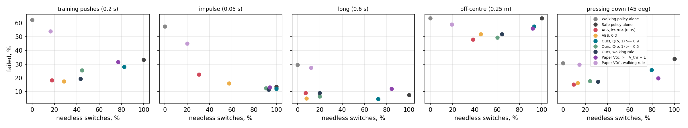
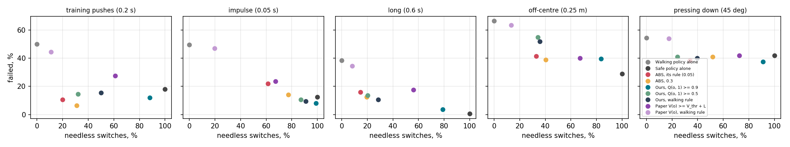

# MPS against ABS, v2: delayed-switch value on the policy's observation, tested on unseen pushes

2026-11-12 · riccardobussola · Go2 and Aliengo, Gazebo with the motors' torque-speed curve, the
walking and safe policies `<robot>_velocity_{normal,safe}` unchanged · everything rerun from scratch
(`components/safe_rl/v2/run_v2.sh`), nothing from the earlier studies reused · tables:
[go2_v2_oct.md](go2_v2_oct.md), [aliengo_v2_oct.md](aliengo_v2_oct.md)

## Summary

Three changes to our value function (ours, MPS), with ABS given the same input and data budget:

1. **Input: the policy's own observation** (228 floats: 5 frames at 50 Hz of accelerometer, gyroscope,
   gravity, q, q̇, actions, plus the command), the same for ABS. The old V saw 30 values without the
   accelerometer or any history, so a push was invisible until the legs reacted.
2. **The delayed-switch value Q(o, Δ)**: the chance that the safe policy recovers if the walking policy
   acts Δ more policy steps before the handover. The filter keeps walking while Q(o_k, 1) ≥ threshold,
   decided at the inference tick, before the network runs. This is the MPS check on the next state,
   with no latency and no Lipschitz margin.
3. **Data and training**: handovers from the first inference after the push starts up to 0.7 s later,
   plus 30 % during undisturbed walking. Every walking observation within 10 steps of the handover is a
   sample (≈6,900 per robot instead of ≈300). Monte Carlo cross-entropy instead of TD(0).

**Result.** At a threshold calibrated on training data so that ours never switches on undisturbed
walking (the walking rule), **ours ties ABS overall on both robots**. It wins clearly on impulsive
pushes on both robots and loses on off-centre pushes on the Aliengo.

| % failed, ours (walking rule) / ABS (its rule) | Go2 | p | Aliengo | p |
|---|---|---|---|---|
| Training-like pushes (0.2 s) | 19.0 / 18.0 | 0.88 | 15.5 / 10.5 | 0.12 |
| Impulse (0.05 s) | **11.5** / 22.5 | 3e-4 | **9.5** / 22.0 | 4e-7 |
| Long (0.6 s) | 9.0 / 9.0 | 1 | 10.5 / 16.0 | 0.08 |
| Off-centre (0.25 m lever) | 52.0 / 48.0 | 0.26 | 52.0 / **41.5** | 7e-4 |
| Pressing down (45°) | 17.0 / 15.0 | 0.48 | 40.0 / 38.5 | 0.66 |
| **4 unseen families pooled** (800 pushes) | 22.4 / 23.6 | 0.39 | 28.0 / 29.5 | 0.31 |

- Compared with the earlier study, the gap is closed on ABS's own distribution. There, ABS beat ours
  significantly on both robots (Go2 20.0 vs 32.5 %, p = 2e-5). Now it's a tie.
- **MPS does not beat ABS in general.** It wins where the safe policy is strong for that disturbance,
  and it can't do better than the safe policy elsewhere. This is what the method promises, nothing more.
- The a-priori threshold of 0.9 is **not usable**. Q(o, 1) dips below 0.9 on undisturbed walking in
  23 % (Go2) and 34 % (Aliengo) of the rollouts, so that filter stops the robot without any push. Its
  better numbers on impulses and long pushes partly come from the robot already standing in the safe
  policy when the push arrives. Its results are in the tables but are not a fair comparison.
- **The paper's V(o) needs Monte Carlo targets (§3).** Trained by TD(0) as in Eq. 2–4, it ranks
  handovers well (AUC 0.94–0.96), but its values are compressed around 0.5. Sec. II-C's threshold
  then hands over during normal walking in 54–75 % of the rollouts. Trained with Monte Carlo targets
  it is calibrated (handovers rated ≥ 0.8 recover 92–95 % of the time) and never switches on normal
  walking at a probability fixed in advance. The Lipschitz margin, estimated as in the paper, comes
  out at about 0 (V is flat where it is measured), so it gives no protection where the switch happens.
  In closed loop the TD(0) version either stops the robot before most pushes (at V_thr + L) or
  hardly reacts (at the walking rule), and isn't usable as a shield.




*Each arm on each push family: lower left is better. Needless: switches in pushes the walking policy
alone survives.*

## Update, 2026-11-13: the retrained safe policies

Everything below the Summary was measured with the October safe policies. This section repeats the
study with the safe policies retrained on the handover distribution (§5, item 1), with **the same push
tests and seeds**, so every row pairs push by push with the October ones. Tables:
[go2_v2.md](go2_v2.md), [aliengo_v2.md](aliengo_v2.md);
figures `<robot>_v2_kick.png`, `<robot>_v2_tradeoff.png` in this folder.

**Safe policies.** Isaac runs `unitree_{go2,aliengo}_safe/2026-11-12_*_handover`, stopped at about
65.5k iterations. Go2: `model_64700`. At iteration 65131 the value loss spiked to 2139 and training
falls jumped from below 1 % to about 25 %; 64700 is before both that and a slow rise in falls from about
64,775. Aliengo: `model_65300`, the last checkpoint, with no spikes. Installed as
`<robot>_velocity_safe.onnx`; the October ones are kept as `<robot>_velocity_safe_oct.onnx`.

| % failed, safe policy alone from the push start | Go2, Oct → new | Aliengo, Oct → new |
|---|---|---|
| Training-like (0.2 s) | 34.0 → **0.0** | 18.0 → **0.0** |
| Impulse (0.05 s) | 13.5 → **0.5** | 12.5 → **1.5** |
| Long (0.6 s) | 7.5 → **0.0** | 0.5 → 0.0 |
| Off-centre (0.25 m) | 63.5 → **5.0** | 29.0 → **1.5** |
| Pressing down (45°) | 34.0 → **2.0** | 42.0 → **13.0** |

Every change is significant (exact McNemar, p ≤ 6e-5) except the Aliengo long push. The new safe
policies train on force pushes of 0.05–0.6 s with off-centre and downward parts, so **the five
families are no longer new to the backup**; they are still new to every value function.

**Value functions.** New MPS data (1,000 episodes per robot, the same recipe) with the new backup;
Q, the paper's V by Monte Carlo and by TD(0) retrained on it. ABS's value describes the walking
policy and is unchanged (same model, same data). Calibration on the same training data as before.

| | Go2 | Aliengo |
|---|---|---|
| Ours Q(o, 1), held-out AUC (Oct → new) | 0.979 → 0.993 | 0.942 → 0.994 |
| Ours, walking-rule threshold | 0.53 → **0.37** | 0.67 → 0.70 |
| Paper V, Monte Carlo: AUC on handovers; recovered with V ≥ 0.8 | 0.970; 99 % | 0.992; 98 % |
| Paper V, TD(0): AUC on handovers; mean V recovered / failed | 0.962; 0.51 / 0.18 | 0.997; 0.45 / 0.11 |
| Paper V, TD(0): V_thr + L | 0.46 + 0.10 = 0.57 | 0.32 + 0.11 = 0.44 |

**Closed loop, mean over the five families** (% of pushes; 200 per family, no push lost to missed
control ticks). Needless: switches in pushes the walking policy alone survives.

| | Go2 failed | Go2 needless | Aliengo failed | Aliengo needless |
|---|---|---|---|---|
| Walking policy alone | 48.7 | 0 | 51.8 | 0 |
| Safe policy alone (from the push start) | 1.5 | 100 | 3.2 | 100 |
| ABS, its rule (0.05) | 8.0 | 20 | 16.9 | 33 |
| ABS, 0.3 | **6.1** | 30 | 15.4 | 43 |
| Ours, walking rule | 16.3 | 19 | 13.5 | 58 |
| Ours, Q ≥ 0.5 | 15.6 | 20 | 16.1 | 47 |
| Ours, Q ≥ 0.9 | 10.7 | 31 | 9.7 | 77 |
| Ours, Q ≥ 0.95 | 10.8 | 37 | 7.9 | 84 |
| Ours, Q ≥ 0.99 | 7.3 | 50 | **3.6** | 100 |
| Paper V, TD(0), V_thr + L | 9.7 | 77 | 29.8 | 47 |
| Paper V, TD(0), walking rule | 40.2 | 17 | 45.7 | 13 |
| Paper V, Monte Carlo, 0.8 + L | 45.3 | 2 | 49.5 | 4 |

Per family, % failed:

| | Train | Impulse | Long | Off-centre | Down |
|---|---|---|---|---|---|
| Go2, ABS (0.05) | 2.0 | 7.5 | 0.5 | 22.5 | 7.5 |
| Go2, ours 0.9 | 4.5 | **2.5** (p 0.03) | 6.0 (p 0.003) | 34.5 (p 7e-4) | 6.0 |
| Go2, ours 0.99 | 2.5 | **1.0** (p 1e-3) | 1.0 | 27.0 | 5.0 |
| Aliengo, ABS (0.05) | 3.5 | 8.5 | 7.0 | 37.0 | 28.5 |
| Aliengo, ours 0.9 | 1.0 | **3.0** (p 3e-3) | **2.5** (p 0.04) | **24.0** (p 4e-4) | **18.0** (p 5e-5) |

p: exact McNemar against ABS at its rule, shown where it is below 0.05 or worth reading.

What it shows:

- **The backup was the bottleneck.** With the new safe policies every filter fails far less: ABS
  8.0 % / 16.9 % (was 23.7 / 29.5 % on the unseen families), ours at 0.9 10.7 / 9.7 %.
- **Ours does what the method promises.** At threshold τ a handover fails with probability at most
  1 − τ if Q is calibrated. On the Go2 training-like pushes, of the handovers ours made at 0.9, 5.8 %
  failed (≤ 10 %); at 0.5, 11.5 % (≤ 50 %). It is not bounded by the safe policy's own success rate:
  "safe policy alone" hands over at the push start, which no filter knows.
- **Go2: ABS is better.** Ours loses on long and off-centre pushes, and every failure of ours on the
  training-like pushes is a late handover (0.23–0.84 s after the push start). With a backup that
  recovers almost everything, ABS's implicit assumption (the backup always recovers) is nearly true,
  and its early, conservative switch is nearly optimal. Ours at 0.99 gets closest (7.3 %) but only by
  switching needlessly in half the pushes; ABS at 0.3 fails 6.1 % at 30 %.
- **Aliengo: ours fails less, but by switching more.** At 0.9 it beats ABS on four families out of
  five, at 77 % needless switches against 33 %. At a matched needless rate the two are about even
  (ours 0.5: 16.1 % at 47 %; ABS 0.3: 15.4 % at 43 %). What ours adds is a threshold that reaches the
  low-failure end (0.99: 3.6 %, which is the safe policy alone), which ABS's threshold doesn't
  (0.05 → 0.3 moves it from 16.9 to 15.4 %). But on the Aliengo 0.99 switches before the push in
  53 % of the episodes (0.95: 12 %, 0.9: 7 %; Go2 0.99: 13 %), so that point is the safe policy at a
  random time, not a filter.
- **The same τ means different behaviour on the two robots.** At 0.9 the Aliengo filter is nearly
  "switch at any push", the Go2 filter waits too long. A probability threshold is comparable across
  robots only if Q is calibrated on the walking states during a push, which the held-out AUC doesn't
  check.

**The paper's V(o) fails in closed loop, by TD(0) and by Monte Carlo alike.** TD(0) repeats October: at
V_thr + L it switches before the push in most episodes (Go2: 84–89 % switched, median 1.3 s before the
push), at the walking rule it barely reacts. The Monte Carlo version, calibrated on handovers, switches
in only 2–12 % of the pushes. Both are trained on the safe policy's states only, but the filter
evaluates them on the walking policy's states. On the held-out MPS episodes, the walking observations
1–10 steps before a handover (labelled by whether that handover recovered):

| AUC; mean on recovered / failed | Go2 (983, 172 failed) | Aliengo (609, 206 failed) |
|---|---|---|
| Ours Q(o, Δ) | **0.994**; 0.98 / 0.07 | **0.964**; 0.96 / 0.19 |
| ABS −V_RA | 0.975; 0.85 / −0.54 | 0.965; 0.85 / −0.47 |
| Paper V, Monte Carlo | 0.729; 0.999 / **0.974** | 0.765; 0.993 / **0.988** |
| Paper V, TD(0) | 0.735; 0.56 / 0.50 | 0.681; 0.50 / 0.43 |

On the walking states that are about to fail, the Monte Carlo V still says 0.97–0.99 (97–100 % of them
≥ 0.8). **What the paper's V lacks is not the target but the training distribution**: it has to be
trained on the states where the filter queries it, with the handover after them, which is what
Q(o, Δ) is. Monte Carlo targets make V a probability (needed for the bound), training on walking
states makes it work as a filter; ours has both. This replaces the conclusion of §3 ("needs Monte Carlo
targets"): needed, but not enough.

**For the paper.** The claim that holds: the risk of a handover is bounded by 1 − τ for any backup,
and the threshold trades needless switches for failures down to the backup's own rate. Beating ABS
is not a claim that holds in general: with a near-perfect backup ABS's assumption is true and it is
at least as good (Go2); with a weaker one ours wins (October Aliengo impulses, new Aliengo) at a cost
in needless switches.

Reproduce: `run_v2.sh go2 aliengo` with the current `<robot>_velocity_safe.onnx` (it now trains and
tests every arm above, the paper's TD(0) V and ours at 0.95 and 0.99 included). The walking-state check
above is `walk_states.py <robot>`; it reuses `train.py`'s held-out split. The datasets were deleted on
2026-11-16; the models are kept in `models/` next to this report.

## 1. Setup

- **Data** (per robot): 1000 MPS episodes, of which 900 were usable: 807–820 for training and 150 held
  out, timeouts left out. The robot walks at a random command (±0.5), gets a training push 2–3 s in (a
  force of mass × kick / 0.2 s for 0.2 s, kick uniform in 0–2.5 m/s on the Go2 and 0–3 m/s on the
  Aliengo, random horizontal direction), and the safe policy takes over at the first inference 0.02–0.7 s
  after the push starts. 30 % of the episodes have no push and a handover during walking. ABS gets
  600 walking-policy rollouts with the same pushes. Ornstein-Uhlenbeck torque noise and the motor curve
  throughout.
- **Labels**: failure is leaving the safe set (fall rule, base or hip below 0.1 m, knee below 3.5 cm,
  joint position or velocity limit); success is reaching X_inv (static equilibrium and capture point in
  the polygon, held 0.3 s). Episodes that fail before their scheduled handover label their walking
  observations 0 at the scheduled Δ: these are the "too late" examples.
- **Q(o, Δ)**: the samples are (o_s, Δ = h − s) for walking observations within 10 steps (0.2 s) of
  the handover h, and (o, 0) for the safe policy's observations, all labelled with the episode's
  outcome. Walking observations of a pushed episode count only after the push has started, since a
  future push can't be predicted. The walking samples weigh as much as all the safe-policy samples.
  Held-out AUC at Δ = 1: Go2 0.979, Aliengo 0.942.
- **ABS**: the published discounted reach-avoid value of the walking policy (γ = 0.999999, ζ softened
  over the last 10 states, target margin from the command-tracking error), TD with a target network,
  switching at V_RA ≥ −0.05. Held-out squared error against the Monte Carlo reach-avoid value: 0.011.
- **Thresholds**, all fixed before the tests: ABS's rule (0.05) and 0.3; ours at 0.9, at 0.5, and at
  the **walking rule**. The walking rule is the 1st percentile, over the 600 ABS training rollouts, of
  each rollout's lowest Q(o, 1) before its push: Go2 0.533, Aliengo 0.667. During the tests' undisturbed
  walking it switched in 1.3 % and 0.9 % of the episodes, ABS in none.
- **Tests**: 5 push families × 200 pushes (kicks 1.0–1.8 m/s on the Go2 and 1.2–2.0 m/s on the Aliengo,
  random direction and time). The same pushes for every arm, paired by seed; no episode was lost to
  missed control ticks. Episodes last 7 s or end at the first failure. Once switched, the safe policy
  keeps the robot. Families other than "training" never appear in either value function's data.
  - impulse: 0.05 s at 4× the force
  - long: 0.6 s at a third of the force
  - off-centre: the force applied 0.25 m ahead of or behind the base, adding a torque
  - pressing down: as much force downward as horizontal

## 2. What the tests show

**Ours is as good as its backup.** On every family, ours tracks how well the safe policy handles that
disturbance:

| % failed | Go2: safe alone | Go2: walk alone | Aliengo: safe alone | Aliengo: walk alone |
|---|---|---|---|---|
| Training-like | 34.0 | 62.0 | 18.0 | 50.0 |
| Impulse | 13.5 | 57.5 | 12.5 | 49.5 |
| Long | 7.5 | 29.5 | 0.5 | 38.5 |
| Off-centre | 63.5 | 63.5 | 29.0 | 66.5 |
| Pressing down | 34.0 | 31.0 | 42.0 | 54.5 |

("Safe alone" hands over at the first inference after the push starts, so it knows when the push
starts. It is an oracle, not a filter.)

- **Impulses**: the safe policy was trained on instantaneous velocity kicks, so it is strong here.
  Ours hands over at once (median 0.03 s) and fails half as often as ABS. ABS keeps the walking policy
  for 0.10–0.12 s into the push.
- **Go2, training-like, off-centre, pressing down**: the Go2 safe policy is weak. It is no better than
  walking off-centre, worse than walking when pressed down (it folds onto its knees: 27 % knee
  contacts), and worse handed over at onset than at the push's end. ABS rides out the push on the
  walking policy and hands over around 0.2 s, and ties or slightly beats ours.
- **Aliengo, off-centre**: the one significant loss (52.0 vs 41.5 %), although the safe policy alone
  does best of all here (29 %). Ours switches less often (58 %) and later than it should: Q
  over-estimates recovery under the unseen torque, since rotational disturbances never appear in its
  data. A learned value function has no guarantee outside its data, ours included.
- **Aliengo headroom is in the value function**: the onset oracle (safe alone, 21.0 % on the unseen
  families) beats every filter (28–30 %). **Go2 headroom is in the backup**: the oracle is the worst
  filter-like arm there (29.6 %).

**Why not hand over earlier when Q falls?** At 0.9 the filter hands over at 0.04 s. On the Go2
training-like pushes, among the 120 pushes the walking policy fails and both filters switch, ABS
(median 0.19 s) fails 33 and ours (0.04 s) fails 42. Handing this Go2 safe policy a robot still being
pushed is worse than handing it over as the push ends. Q learned the opposite trend from the few early
handovers in its data (about 28 % of handovers fall in the push's first 0.2 s). An "improve" rule
(switch only if Q(o, 0) − Q(o, 10) > ε) didn't change this: replayed offline on the walking
trajectories, Q always rates handing over now above waiting 0.2 s. It is in `shield.py`
(`--shield-rule improve`) but wasn't run in closed loop.

## 3. The paper's own V(o): TD(0) against Monte Carlo

Q(o, Δ) changes two things at once: the target and the definition (a delayed switch). To separate
them, the paper's V(o) was trained as written (Sec. II-B): the chance that the safe policy recovers
when it takes over at o. It used the same data and input as Q, but only the safe policy's
observations from the handover on, in two ways:

- **TD(0)**, Eq. 2–4: target network (EMA 0.99), squared TD error, sigmoid output
  (`train.py --method paper`).
- **Monte Carlo**: cross-entropy against the episode's outcome on every sample, no bootstrapping
  (`--method paper_mc`). This is the target Q already uses.

Then Sec. II-C's switching rule, walk while V(o_k) ≥ V_thr + L, calibrated on the training data
(`calibrate_paper.py`). The calibration data is the 600 ABS rollouts of the walking policy, and the
rollouts it survives play the "pushes that don't require switching". V_thr is the value under
99 % of their states. L = max ratio × max step, after the paper's 5 % + 5 % trimming.

| Held-out handovers (≈124 per robot, 21 failed) | TD(0) Go2 | TD(0) Aliengo | MC Go2 | MC Aliengo |
|---|---|---|---|---|
| AUC | 0.961 | 0.935 | **0.983** | 0.918 |
| mean V, recovered / failed | 0.54 / 0.17 | 0.53 / 0.27 | **0.97 / 0.26** | **0.97 / 0.46** |
| recovery rate among handovers with V ≥ 0.8 | – (none) | – (none) | **0.95** (105) | **0.92** (106) |
| recovery rate among handovers with V < 0.2 | | | 0.07 (15) | 0.10 (10) |
| V on surviving walking, 1st / 50th percentile | 0.41 / 0.51 | 0.41 / 0.53 | 0.996 / 0.999 | 0.997 / 0.998 |
| Sec. II-C: V_thr, L | 0.41, 0.11 | 0.41, 0.11 | 0.996, 3e-4 | 0.997, 2e-4 |
| walking rollouts that switch before the push at V_thr + L | **75 %** | **54 %** | 5 % | 17 % |
| ... at a fixed p + L, p = 0.5 to 0.9 | | | **0 %** | **0 %** |

**TD(0) fails on this data, and Monte Carlo fixes it.**
- The TD(0) V ranks handovers well, but its values are compressed around 0.5. Bootstrapping over
  ~100 safe-policy steps on an observation that isn't the state propagates the terminal labels
  only partly.
- So V = 0.5 doesn't mean a 50 % chance, and Sec. II-C's threshold lands at the median of normal
  walking.
- The Monte Carlo V is calibrated where it matters. Handovers it rates ≥ 0.8 recover 92–95 % of
  the time, those under 0.2 recover 7–10 %. On normal walking it sits at 0.996–0.999.

**Sec. II-C's two estimates don't hold, even with a calibrated V.**
- *V_thr as a per-state percentile.* "Below 99 % of the walking states" lets about 1 % of the
  steps through. An episode has ≈350 steps and the switch is permanent, so most episodes cross it
  at some point. With the TD(0) V that is 54–75 % of the rollouts. With Monte Carlo it is 5–17 %,
  only because V is so saturated on walking.
  - The quantity to calibrate is per rollout: "at most x % of normal-walking rollouts switch".
- *L from pushes that don't require switching.* On those states a good V is flat at about 1, so
  the measured L_V is about 1e-5 and L about 3e-4. The margin is estimated exactly where V doesn't
  move, and it comes out about zero. The decision is made where V falls from 1 to 0 within a few
  policy steps.
  - The paper's estimate therefore doesn't bound the variation that matters. A real bound needs
    pushed states near the switch, where it gets large and conservative. This is the gap
    Q(o, 1) closes by learning the one-step lookahead directly.

**What we suggest for the paper's V(o) (Sec. II-B/C):**
1. **Monte Carlo targets** (or a TD(0) V recalibrated, Platt or isotonic, on held-out training
   handovers). Then V means a probability.
2. **A probability fixed in advance**: walk while V(o_k) ≥ p + L, with p set by the required
   recovery rate (e.g. 0.8) and not tuned. With the Monte Carlo V, normal walking never switches for
   any p from 0.5 to 0.9 (0 of 600 rollouts per robot). The false-alarm rate is then a result to
   report, not a quantity to tune.
3. **Report the per-rollout false-alarm rate** on normal walking instead of the per-state percentile.
4. Present L honestly. As estimated it is about 0. Either estimate it on pushed states near the
   switch, or replace V(o_k) ≥ p + L with Q(o_k, 1) ≥ p (§1), which is the same check learned.
5. **Calibrate on a separate set.** All calibration uses training-distribution data, never the
   tests. To leave the training data untouched, collect a calibration set with new seeds (training
   push and normal walking only).

**Closed loop, the TD(0) V (current safe policies, the same 5 × 200 paired pushes).**

| % failed | Go2 training-like | Go2 unseen pooled | Aliengo training-like | Aliengo unseen pooled |
|---|---|---|---|---|
| ABS, its rule | 18.4 | 23.7 | 10.5 | 29.5 |
| Ours, Q(o, 1), walking rule | 19.4 | 22.4 | 15.5 | 28.0 |
| Paper V(o) ≥ V_thr + L | 31.6 (p 0.002) | 25.2 (p 0.38) | 27.5 (p 1e-7) | 30.8 (p 0.49) |
| ... handed over before the push | 81 % | 78 % | 52 % | 55 % |
| Paper V(o), walking rule | 54.1 (p 2e-18) | 40.4 (p 3e-26) | 44.5 (p 1e-19) | 49.8 (p 3e-39) |
| Walking alone / safe alone | 62.2 / 33.2 | 45.4 / 29.6 | 50.0 / 18.0 | 52.2 / 21.0 |

*p: exact McNemar against ABS. Unseen pooled: impulse, long, off-centre, pressing down (≈800 pushes).*

- **At Sec. II-C's threshold, the paper's filter isn't a shield.** It stops the robot before any push
  in most episodes (median switch 1.3 s *before* the push), so it behaves like the safe policy at a
  random time.
  - It ties ABS on the unseen families only because of that, and it loses clearly on the
    training-like pushes on both robots.
- **At the walking rule, the TD(0) V hardly detects pushes.** It switches late or not at all and stays
  close to the walking policy alone.
- Neither version is a usable shield. Both point to the target (TD(0)), not to the definition of V:
  the Monte Carlo V of the same definition is calibrated (table above).
- The Monte Carlo arm (`paper_mc`, p = 0.8 + L) is in `run_v2.sh`. It will be tested in closed loop
  with the retrained safe policies (§5), together with new MPS data for them.
- One rerun: the Go2 pressing-down `paper` cell first lost 172 of 200 episodes to missed control
  ticks, while the Isaac retrains were starting on the same machine. It was rerun with the same
  seeds. Every other cell lost at most 4.

## 4. What this means for the paper

- The principled claim holds, and it's narrower than "MPS beats ABS": **ours is safe to the extent the
  backup is, and it knows it on the states it was trained on.** Ours beats ABS significantly where the
  backup is strong and the disturbance is new to ABS (impulses, both robots, p ≤ 3e-4). Overall the two
  tie.
- ABS's advantage is structural on disturbances that the *walking* policy handles better than the safe
  policy. MPS by construction never relies on the walking policy's robustness.
- The paper's percentile threshold, and any fixed probability such as 0.9, needs the walking rule on
  training data: Q is under-confident on some undisturbed walking states, though no walking handover
  in the data ever failed (0 of 572).
- The sensor-based scheme of Sec. II-C is now simpler: Q(o, Δ) on the policy's observation replaces
  both state estimation and the Lipschitz margin.

## 5. Next steps, by expected gain

1. **Retrain the safe policies on the handover distribution (in progress, both robots).** Hand them
   robots under a force still acting, including off-centre and downward forces, and penalise knee
   contact. The Go2 safe policy is the limit on 3 of 5 families. The Aliengo is retrained too, so
   that both backups, and so both feasibility sets, are defined by the same recipe.
   - Isaac: `apply_handover()` in safe_rl `safe_env_cfg.py`. It adds a `ForcePush` (0.05–0.6 s,
     a 0.5–2.0 m/s velocity change; 30 % press down, 30 % off-centre up to 0.25 m), a `knee_height`
     penalty below 8 cm, and a `knee_contact` termination below 3.5 cm. It sits on top of the
     velocity-reset pushes, which stay. Runs `unitree_{go2,aliengo}_safe/2026-11-12_*_handover`,
     resumed from the velocity baselines.
   - After the export, MPS's value functions (Q, V) need **new MPS data**, because they describe the
     backup. ABS's data (walking-policy rollouts) stays valid.
   - Then rerun the test grid with `paper_mc` included.
   - The new safe policy trains on force pushes, so the test families are no longer new to the
     backup. They are still new to both value functions.
2. **More handovers early in the push.** Draw the handover window non-uniformly, for example half of
   them in the first 0.25 s, so that Q's Δ dependence is learned where the decision is made.
3. **Rotational and vertical disturbances in the data** (torques, downward components), at least for
   the Aliengo off-centre loss.
4. If the paper should show a strict improvement over both: the optimal-stopping combination of ABS's
   value and ours (`../v1/mps_vs_abs_diagnosis.md`, §8).

## 6. Reproduce

```bash
cd ~/trento_lab_home/ros_ws/src/locosim/robot_control/base_controllers
components/safe_rl/v2/run_v2.sh go2 aliengo                 # data, train, calibrate, test, summary
STAGES="test summary" ARMS="mps_wr" components/safe_rl/v2/run_v2.sh go2   # one arm again
STAGES="test summary" ARMS="paper paper_wr paper_mc" components/safe_rl/v2/run_v2.sh go2 aliengo  # the paper's V
# the paper's V is trained and calibrated by hand (not a stage):
#   train.py --method paper_mc --data data/<robot>/mps/batch*/ --out models/VF_paper_mc_<robot>
#   calibrate_paper.py --model models/VF_paper_mc_<robot>.onnx --abs-data data/<robot>/abs/batch*/ --write
```

About 1 h of data and training plus 1.5–2 h of tests per robot (10 Gazebo containers in parallel).
Code: `v2/train.py` (Q(o, Δ), ABS, the paper's V by TD(0) or Monte Carlo), `v2/calibrate_paper.py`
(Sec. II-C's V_thr and L, false alarms at fixed p), `v2/calibrate.py` (walking rule), `v2/shield.py` (the filter),
`v2/summarize.py`; the hook `VelocityPolicy.on_observation` in `rl_quadruped/velocity_policy.py`, and
`--v2`, `--shield*`, `--push-*` in `saferl_controller_dataset.py`. Data in `v2/data/` (git-ignored; the study's datasets were deleted on 2026-11-16), the final models in `reports/v2/models/`.
