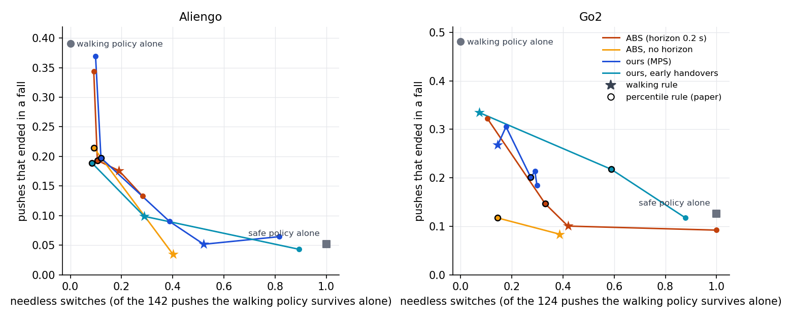
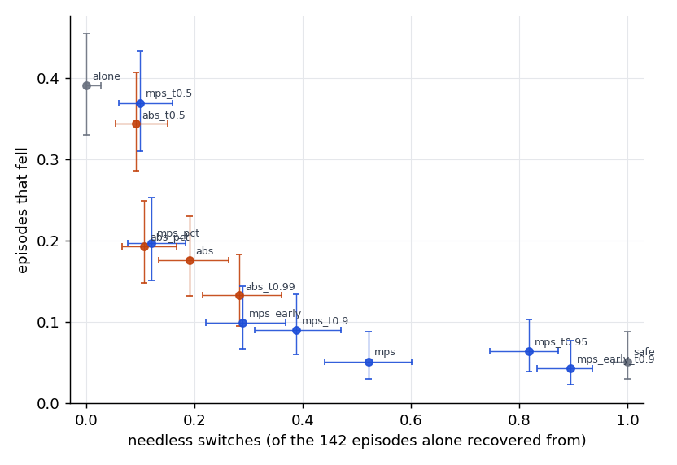
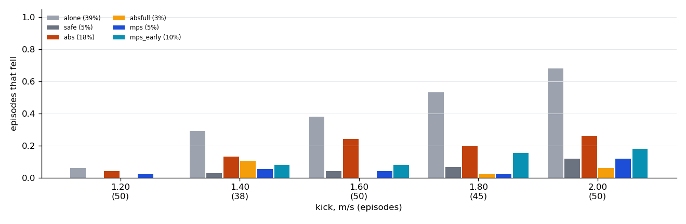
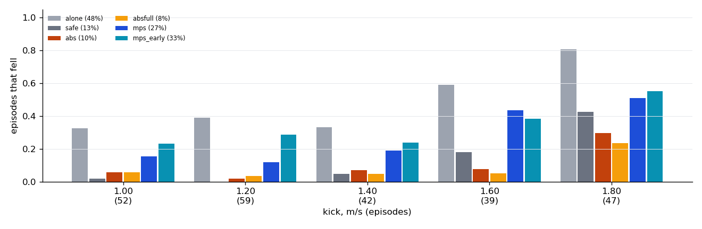

# Value function for model predictive shielding: ours (MPS) against the ABS baseline

2026-11-05 · riccardobussola · Aliengo and Go2, walking and safe policies `<robot>_velocity_{normal,safe}`
· `robot_control` branch `feat/vf_abs_vs_mps` · every number from one run of `run_pipeline.sh`
(`report_figures/<robot>_summary.txt`, tables `report_figures/<robot>_loop_*.md`)

## Summary

The safety filter switches the robot from the walking policy to the safe policy (zero-command
recovery) when a learned value function V drops below a threshold. Two value functions come out of
the same pipeline, data and network:

- **Ours (`mps`)**, the paper's: V(x) is the chance that the **safe policy**, started at x, brings the
  robot to rest without a fall. Data: the walking policy, a push, a warm-up of 0–0.5 s, then the
  safe policy recorded until a fall or rest. The filter walks while V ≥ threshold + L, L the margin
  of Eq. (5).
- **ABS (`abs`)**, the baseline: V(x) is about the **walking policy**: does it fall within 0.2 s (the
  original ABS horizon, 10 samples). `absfull` is the same without the horizon.

On 240 pushes per robot (150–250 N on the Aliengo), the same pushes for every configuration, with
the safe policy kept once switched (the paper's protocol):

| Falls (paper rule: trunk or hip < 0.1 m) | Aliengo | Go2 |
|---|---|---|
| Walking policy alone | 39 % (31 %) | 48 % (15 %) |
| Safe policy alone, from the push | 5.2 % (0.9 %) | 12.6 % (3.3 %) |
| ABS, walking rule | 17.6 % (6.9 %) | 10.0 % (1.3 %) |
| ABS without horizon, walking rule | **3.4 %** (1.7 %) | **8.4 %** (4.2 %) |
| Ours, walking rule | **5.2 %** (1.7 %) | 26.8 % (7.1 %) |
| Ours, the paper's percentile rule | 19.7 % (8.2 %) | 20.1 % (9.6 %) |

- **The threshold matters most.** The paper's rule (the 1st percentile of V over the walking
  policy's states) is fragile: it sits on the steep drop of V before a fall and moves with the share
  of falling states (0.5th, 1st, 2nd percentiles 0.38, 0.77, 0.92 for one model; near 0 for
  others). The **walking rule**, the highest threshold at which the filter never switches during
  undisturbed walking (threshold + L = the lowest V over 11 min of walking), cuts the falls 1.1 to
  6 times for every value function but ours on the Go2 (whose values on walking are low, below),
  with switches during undisturbed walking in at most 0.4 % of the episodes.
- **Aliengo, a strong safe policy (5 % falls alone):** ours brings the falls from 39 % to 5.2 %, the
  safe policy's own level, statistically equal to ABS without horizon (3.4 %, McNemar p = 0.45) and
  far better than ABS with its original horizon (17.6 %, p = 4e-7).
- **Go2, a weak safe policy (12.6 % falls alone, 11 it causes):** ABS wins (8.4–10 % against 26.8 %,
  p = 5e-8). Our value function is right about the backup: from some states of normal walking the
  Go2's safe policy fails (lowest V on walking 0.44), so a threshold that never interrupts walking
  is low and the filter acts late. The paper's method is only as protective as its backup policy;
  ABS's assumption that the backup always recovers happens to hold better than the backup's real
  record on the Go2.
- **Ablations (Aliengo):** the margin L helps (9.2 % → 5.4 %, p = 0.06; Go2 31 % → 27 %); handing
  over earlier in the data (from the push start) hurts under the walking rule (10 % against 5.2 %,
  p = 0.03), it lowers V on walking; the support-polygon X_inv, sensor-noise augmentation and
  noise-free training make no significant difference; training with 2 % torque noise is worse
  (13.3 %, p = 0.0005). The original ABS 10-sample horizon hurts (17.6 % against 3.4 %).
- **Deployed:** the filter loads, per robot, the value function that fell least: ours on the
  Aliengo (`VF_mps_aliengo`), ABS without horizon on the Go2 (`VF_absfull_go2`), at the walking rule.
  Switching back after 2 s, as the controllers do, costs 1–2 points of falls.



*Each value function at its thresholds (fixed 0.5, 0.9, 0.95, 0.99, the paper's percentile rule
circled, the walking rule starred), the walking policy alone and the safe policy alone. Lower left
is better: fewer falls for fewer needless switches.*

## 1. The two value functions

| | Ours (`mps`) | ABS (`abs`, `absfull`) |
|---|---|---|
| Rollouts recorded | the safe policy, after a warm-up of the walking policy following the push | the walking policy, from the push end |
| Switch times in the data | uniform 0–0.5 s after the push end; 20 % of the episodes during undisturbed walking (no push) | – |
| Success (I_CP = 1) | static equilibrium: trunk and joint angular velocities < 0.1 rad/s, trunk linear velocity < 0.1 m/s, averaged over 0.2 s | capture point within 5 cm of the trunk for 0.5 s, or 3 s survived after the push |
| Failure (I_fall = 1) | inclination > 45° or trunk < 0.2 m | the same |
| Target | Eq. (4): (1 − I_fall)[(1 − I_CP) V(x') + I_CP] | the same; `abs`: only the last 10 transitions before a fall lead to it (the original ABS training) |
| Episodes left out | ending in neither (timeout, 6 s after the switch: 1 of 985) | – |
| Filter | V < threshold + L | V < threshold |

Both take the same 30 inputs, all measured on the robot (projected gravity and angular velocity from
the IMU, joint positions and velocities), the same network (512–256–128, layer norm, ELU, linear
output), the same TD(0) training (Adam 3e-4, target network τ = 0.01, early stopped on the held-out
Brier score) and the same ONNX runtime (0.015 ms per evaluation).

**Static equilibrium, averaged.** With the instantaneous check the robot never reached X_inv: at rest
the safe policy keeps correcting and the torque noise shakes the joints, so the fastest of the 12
joints moves at 0.1–0.3 rad/s at any instant (0.1–0.2 without noise). Averaged over 0.2 s, every
episode that does not fall reaches rest, a median 1.4 s (Aliengo) and 1.3 s (Go2) after the switch.

## 2. Pipeline

`run_pipeline.sh`, per robot, in Gazebo in real time (`report_figures/<robot>_summary.txt`):

- **Episodes.** Reset standing still in the policy's posture, a command uniform in ±0.5, one push 2–3
  s after the start: a force of mass × kick / 0.2 s on the trunk for 0.2 s, the kick uniform in
  0–3 m/s (Aliengo) or 0–2.5 m/s (Go2), the direction uniform; about 45 % of the pushes fall.
- **Torque noise.** An Ornstein-Uhlenbeck process per joint, std 4 % of the joint's torque limit,
  time constant 0.05 s, throughout the episode. The white noise of 2026-10-29 (10 Nm per 2 ms tick)
  shook the robot so much that it never came to rest (max joint speed at rest 0.9–1.1 rad/s).
- **Fall rule.** 240 episodes per robot run to the ground: every fall went past 85° (Aliengo) and 50°
  (Go2); the Aliengo recovered once from 51° (two recoveries past 25° out of 154), the Go2 never past
  23°, the trunk always above 0.22 m. 45° labels one Aliengo recovery a fall; 60° would sit in the gap.
- **Data.** Per method 420 training episodes (70 held out) and 140 test episodes; of the 560 `mps`
  episodes 63 (Aliengo) and 72 (Go2) fell during the warm-up, before the switch, and record nothing.
- **Calibration runs**, the walking policy alone, every state at 100 Hz: 80 episodes of 20 s with one
  push of the evaluation's kicks (11 min of undisturbed walking) for the threshold, 240 with light
  pushes for L.
- **Closed loop.** 240 pushes per configuration, paired by seed: kicks 1.2–2.0 m/s on the Aliengo
  (150–250 N, the paper's range) and 1.0–1.8 m/s on the Go2, 5 magnitudes, random direction and
  time; 7 s per episode; the filter at 100 Hz from 1 s, one value below the level to switch, the safe
  policy kept for the rest of the episode. A configuration whose loop missed control ticks
  discards that episode in all (233–240 kept).

## 3. Offline evaluation (held-out test episodes)

| | AUC 0.2 s after the push | Brier | Falls warned at V < 0.5, median lead | False alarms (light kick / any) |
|---|---|---|---|---|
| Aliengo ABS | 0.72 | 0.125 | 64/64, 0.20 s | 0/44, 1/76 |
| Aliengo ABS no horizon | 0.96 | 0.060 | 64/64, 0.38 s | 1/44, 8/76 |
| Aliengo ours | 0.99 | 0.006 | 19/21, 0.12 s | 0/67, 0/108 |
| Go2 ABS | 0.95 | 0.088 | 69/69, 0.20 s | 0/40, 0/71 |
| Go2 ABS no horizon | 0.93 | 0.056 | 69/69, 0.32 s | 0/40, 8/71 |
| Go2 ours | 0.99 | 0.002 | 19/23, 0.14 s | 0/64, 4/103 |

ABS is scored against the walking policy's outcome, ours against the safe policy's, so the rows
are not comparable across methods; the closed loop is. Ours is well calibrated (Aliengo: V 0.9–1.0
→ 99 % recovered, V below 0.6 → none). ABS's horizon makes it blind until 0.2 s before a fall
(AUC 0.72 on the Aliengo).

## 4. Calibration

| Threshold (+ L) | walking rule | percentile rule | L (Eq. 5) | lowest V on walking |
|---|---|---|---|---|
| Aliengo ABS | 0.986 | 0.976 | (0.002) | 0.986 |
| Aliengo ABS no horizon | 0.772 | 0.022 | (0.022) | 0.772 |
| Aliengo ours | 0.898 + 0.023 | 0.766 + 0.023 | 0.023 | 0.921 |
| Aliengo ours, early | 0.574 + 0.052 | 0.212 + 0.052 | 0.052 | 0.626 |
| Go2 ABS | 0.944 | 0.931 | (0.013) | 0.944 |
| Go2 ABS no horizon | 0.964 | 0.006 | (0.002) | 0.964 |
| Go2 ours | 0.439 + 0.004 | 0.909 + 0.004 | 0.004 | 0.443 |
| Go2 ours, early | −0.079 + 0.113 | 0.396 + 0.113 | 0.113 | 0.034 |

ABS uses no margin (in brackets, Eq. 5 for reference). The percentile rule lands anywhere from
0.006 to 0.976, sometimes above walking values (Go2 ours: 1.3 % switches while walking). On the Go2
our value function drops to 0.44 on some walking states, 0.03 for the early variant: from there the
safe policy is predicted to fail, and a threshold that never interrupts walking has to be lower.

## 5. Closed loop

All in % of the episodes (needless: of those the walking policy alone survived; stopped: of those
the filter switched in, the robot brought to rest). Tables with the paired McNemar tests in
`report_figures/<robot>_loop_<table>.md`.

**Main (walking rule)**

| | Aliengo fell | paper fall | total failures | switched | needless | stopped | Go2 fell | paper fall | total failures | switched | needless | stopped |
|---|---|---|---|---|---|---|---|---|---|---|---|---|
| Walking alone | 39.1 | 30.5 | 48.5 | – | – | – | 48.1 | 15.1 | 43.5 | – | – | – |
| Safe alone | 5.2 | 0.9 | 22.7 | 100 | 100 | 93 | 12.6 | 3.3 | 30.1 | 100 | 100 | 85 |
| ABS | 17.6 | 6.9 | 36.1 | 46 | 19 | 62 | 10.0 | 1.3 | 22.6 | 68 | 42 | 83 |
| ABS no horizon | 3.4 | 1.7 | 13.3 | 62 | 40 | 95 | 8.4 | 4.2 | 18.8 | 67 | 39 | 87 |
| Ours | 5.2 | 1.7 | 22.3 | 70 | 52 | 91 | 26.8 | 7.1 | 30.1 | 52 | 15 | 47 |
| Ours, early | 9.9 | 4.3 | 27.5 | 54 | 29 | 81 | 33.5 | 10.9 | 30.1 | 46 | 7 | 28 |

Total failures: a paper fall, a knee below 3.5 cm or a joint past its URDF limit (Table I of the
paper). Switches during undisturbed walking: 0.4 % (Aliengo ours), otherwise 0–0.4 %.

**Threshold rule (falls, walking rule → percentile rule):** Aliengo ABS 17.6 → 19.3, ABS no horizon
3.4 → 21.5, ours 5.2 → 19.7, ours early 9.9 → 18.9; Go2 ABS 10.0 → 14.6, no horizon 8.4 → 11.7,
ours 26.8 → 20.1, early 33.5 → 21.8 (on the Go2 the percentile rule is higher for ours, at the cost of
switches while walking).

**Fixed thresholds (Aliengo, falls / needless):** ABS 0.5: 34 % / 9 %, 0.99: 13 % / 28 %; ours 0.5:
37 % / 10 %, 0.9: 9 % / 39 %, 0.95: 6 % / 82 % with 8 % switching while walking. 

**Margin L:** Aliengo ours 5.4 % with L, 9.2 % without (p = 0.06); at the percentile threshold 19.6 %
and 24.2 %. Go2 27.1 % and 31.2 %.

**Switching back after 2 s** (the controllers): Aliengo ABS 17.6 → 19.7, ours 5.2 → 6.9 (paper fall
1.7 → 0); Go2 ABS 10.0 → 11.3, ours 26.8 → 29.3; the robot is at rest at the end in fewer episodes,
as it walks again.

**Ablations of ours (Aliengo, walking rule, falls; p against ours):**

| | falls | paper fall | total | needless | p |
|---|---|---|---|---|---|
| Ours (static X_inv, 4 % OU noise) | 5.4 | 1.7 | 22.5 | 52 | – |
| Early handovers (from the push start) | 10.0 | 4.6 | 27.1 | 29 | 0.035 |
| X_inv: capture point in the support polygon | 7.9 | 4.2 | 27.9 | 32 | 0.29 |
| Sensor-noise augmentation (`--obs-noise 1`) | 6.2 | 2.1 | 20.4 | 54 | 0.75 |
| Trained without torque noise | 5.8 | 2.1 | 19.6 | 42 | 1.0 |
| Trained with 2 % torque noise | 13.3 | 6.7 | 33.8 | 28 | 0.0005 |

At the percentile rule the same ablations give 18.8–26.7 %, the differences driven by where each
model's percentile lands.

**Early handovers, at a fixed threshold.** At 0.9 the early variant reaches 4.3 % falls, 0 caused,
but switches during undisturbed walking in 45 % of the episodes: it rates walking lower, and 0.9 is
inside its walking range. Learning to switch during the push needs that data, but its walking states
then look riskier; under the walking rule it is worse than ours.




## 6. What this means for the paper

- The paper's percentile rule should be replaced (or complemented) by the walking rule: it is what
  makes the filters work, for ours and for ABS.
- Ours matches the best filter and the safe policy itself when the safe policy is good (Aliengo),
  and is the only one that tells when it is not (Go2): its V on walking states is a direct measure
  of how much the backup can be trusted. The claim that MPS "guarantees safety without any
  assumption on the backup policy" needs softening: the filter can only be as good as the backup.
- ABS without its 0.2 s horizon is a much stronger baseline than with it, and should be reported.
- The margin L of Eq. (5) helps; it is small (0.004–0.05) and depends on the model.
- `paper/` has the proposed text, tables and figures, marked `\Riccardo{}` in orange, and the diff.

## 7. Reproduce

```bash
cd ~/trento_lab_home/ros_ws/src/locosim/robot_control/base_controllers
components/safe_rl/run_pipeline.sh                    # both robots, about 6 h on 24 cores
components/safe_rl/run_in_image.sh python3 components/safe_rl/plot_tradeoff.py
```

The datasets (`observation_datasets/<robot>/`, about 1.1 GB) are not in the repository; the models
(`value_function/models/VF_{abs,absfull,mps,mps_early}_<robot>.*`) are.
