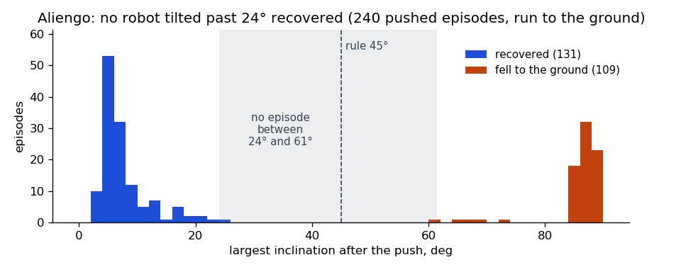
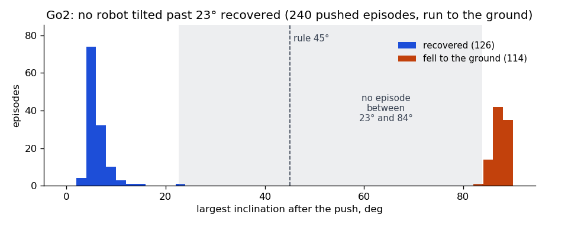
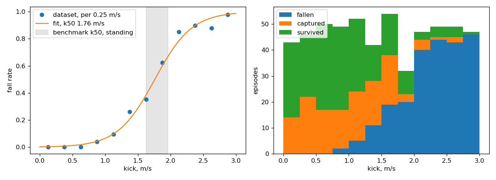
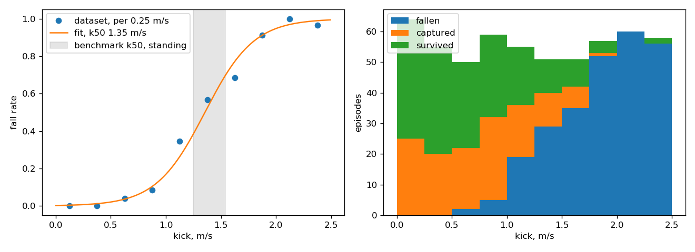
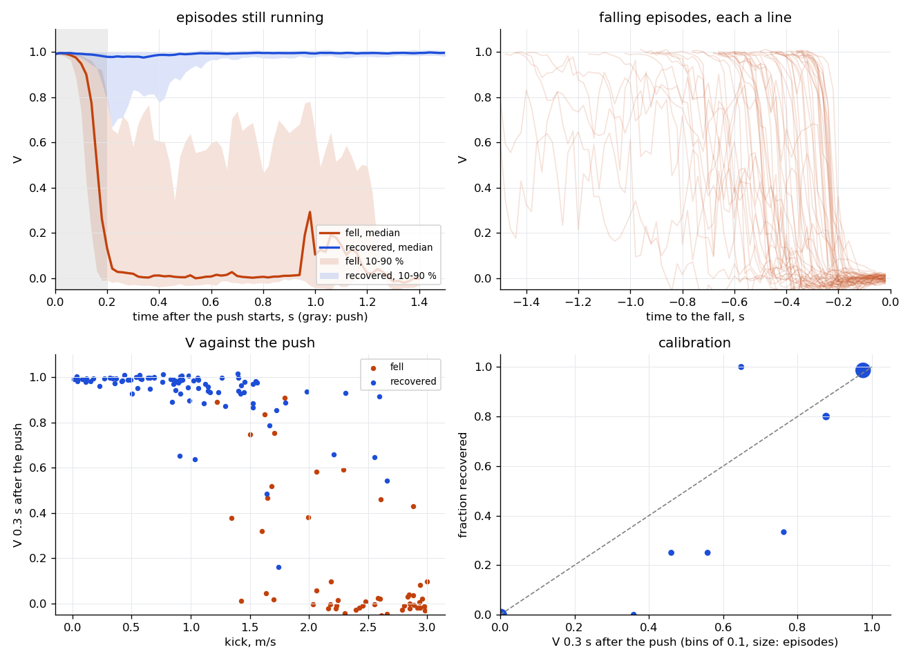
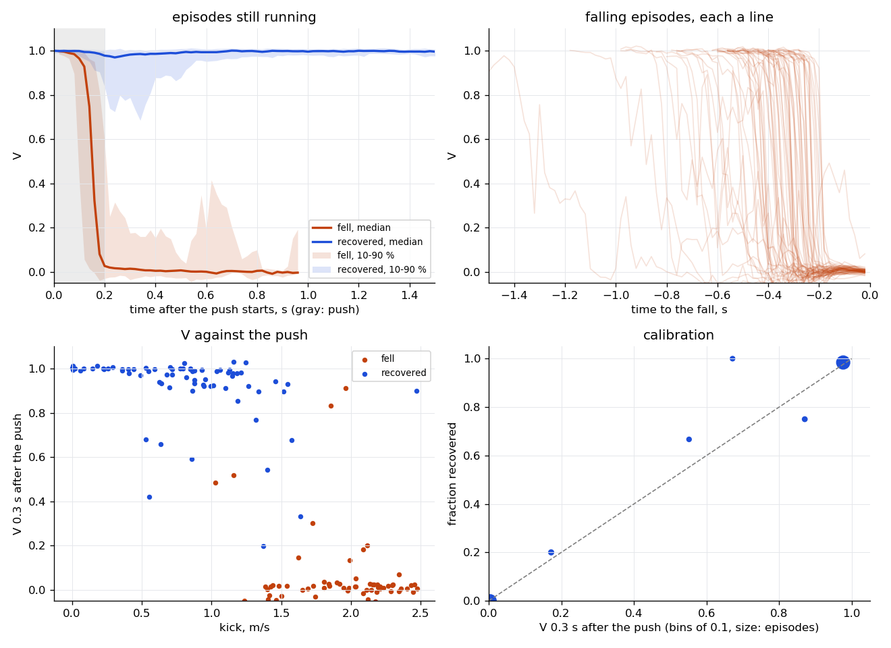
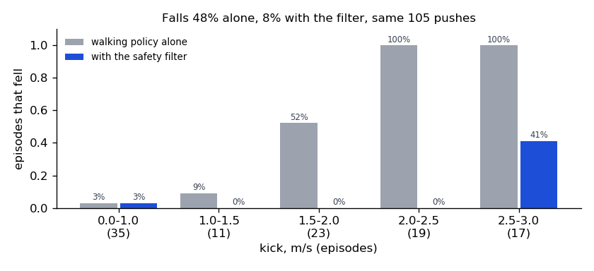
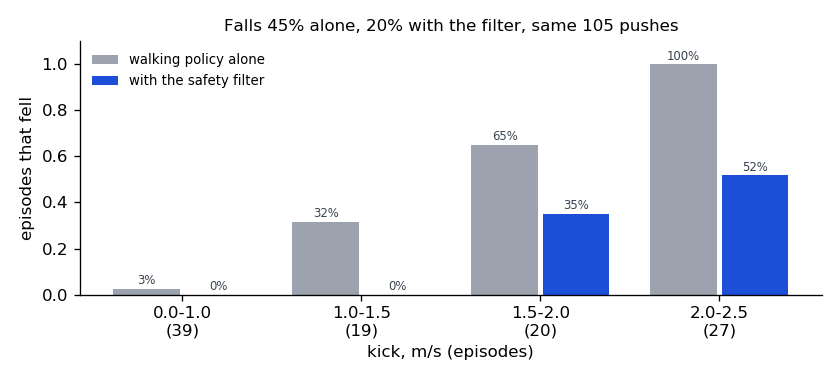

# Safe RL value function: dataset, training and safety filter

2026-10-29 · riccardobussola · Aliengo and Go2, walking policies `<robot>_velocity.json` ·
`robot_control` branch `feat/safe_rl_value_function` · the numbers are from one run of
`run_pipeline.sh`, in `report_figures/<robot>_summary.txt`, except those marked as from development
runs or the push benchmark

The safety filter now does its job on both robots. On the same 105 pushes, switching to the safe
policy below V = 0.5 cut falls from 48 % to 8 % on the Aliengo (42 prevented, none caused) and from
45 % to 20 % on the Go2 (27 prevented, 1 caused). On held-out pushes V tells a fall from a recovery
0.2 s after the push starts (ROC AUC 0.96 and 0.98) and warns of every fall a median 0.41 s
(Aliengo) and 0.32 s (Go2) ahead.

Before the fixes it could not. The model the filter loaded before, on the same Aliengo episodes,
scores AUC 0.59; at its threshold of 0.8 it would switch to the safe policy in 44 of 52 recoveries
from a light push.

| | Aliengo | Go2 |
|---|---|---|
| Fall rule checked (no robot past it recovered) | 45°: recoveries up to 24°, falls past 61° | 45°: recoveries up to 23°, falls past 84° |
| Dataset: episodes, fell | 560, 41 % | 560, 46 % |
| Kick fallen from half the time (k50) | 1.76 m/s | 1.35 m/s |
| ROC AUC 0.2 s after the push starts (test) | 0.96 | 0.98 |
| Falls warned at V < 0.5, median lead (test) | 52 / 52, 0.41 s | 66 / 66, 0.32 s |
| Closed loop: falls alone → with the filter | 48 % → 8 % | 45 % → 20 % |
| Falls prevented / caused | 42 / 0 | 27 / 1 |
| Needless switches: light kick / any recovery | 0 / 34, 9 / 55 | 1 / 30, 13 / 58 |

## What was wrong and what changed

Dataset generation, in `saferl_controller_dataset.py` and `components/safe_rl/dataset_manager.py`:

| | Before | Effect | Now |
|---|---|---|---|
| Velocity command | vx −0.5…1.0, vy ±0.3, wz ±0.7 | the policy walked outside its training range (±0.5) | uniform ±0.5 on vx, vy, wz; 10 % standing, 10 % only turning, as in training |
| Start posture | `q_0` from `params.py` | the policy started from a posture it never saw | the policy's `q_default` (0, 0.9, −1.8) at its standing height, driven there by the PD with gravity off |
| Push timing | 0.5–1 s after the start | the gait had not settled | 2–3 s after the start, random gait phase |
| Push | `set_model_state` set ±3 m/s per axis on every link | joint velocities set to zero, not a push | the push benchmark's push: force mass × kick / 0.2 s on the base for 0.2 s, random direction |
| Simulation | `slow.world` plus a 1 mm contact layer, 0.2× real time | not the conditions the policy runs in | `rl_flat.world`, as `rl_quadruped` runs it, in real time |
| Gains | assumed set by the RL wrapper | `RlVelocityController` sets none | the policy's kp and kd set after every reset |
| Episode end | survivors ran to the step limit with no label | no success label for walking robots | fall, capture, or 3 s after the push survived (success) |
| Fall rule | inclination > 30° | right by a few degrees: a recovery at 29° in a development run | inclination > 45° or base below 0.2 m, checked per robot |
| Capture | capture point within 5 cm for one tick | a robot can stand still on its feet and then fall | within 5 cm for 0.5 s |
| Recording | from the push start | a walking state about to be pushed got that push's outcome: walking itself was learnt as unsafe | from the push end: V is the chance of recovering from a state with no further push |
| Falling episode | last 10 samples in one row; the rest ended unlabelled and was padded as success | states more than 0.2 s before a fall were learnt as safe | one row per episode |
| Robot | Aliengo only | | `--robot aliengo` or `go2`, settings in `ROBOT_SETTINGS` |

Training, in `value_function/train_value_function.py`:

| | Before | Effect | Now |
|---|---|---|---|
| Padding | each row padded with its last state, labelled success | terminal states weighed hundreds of times over the rest, falls taught as success: V ≈ 1 everywhere | padding left out, every real transition a sample |
| Minibatches | 4 whole episodes each | correlated samples | shuffled transitions |
| Normalisation | next states with their own mean and std | V saw the two through different inputs | the states' mean and std for both |
| Stopping | 1000 epochs, no held-out check | the network memorises episodes; on unseen ones false alarms grow with training | `--val`: the epoch with the best held-out Brier score is saved (epoch 75 for both robots here) |
| `load_parameters` | crashed (`model` undefined) | | fixed |

The filter, `value_function_manager.py` and `saferl_controller.py`: the manager runs
`models/VF_push_end_<robot>.onnx` with the threshold at 0.5, and `saferl_controller.py` now actually
switches to the safe policy (the switch was commented out) and shows V in rviz. The README lists
every script and how to run it.

## Fall rule and capture

240 pushed episodes per robot ran until the robot was on the ground (`--fall-check`). A fall
belongs past the point of no return: no robot that tilted past 24° (Aliengo) or 23° (Go2)
recovered, and every fall went past 61° and 84°. The Aliengo sometimes ends lying on its belly
(5 times, base at 0.11 m, upright), so the base height counts too: recoveries never brought it
below 0.29 m (Go2 0.25 m). 45° and 0.2 m sit in the gap for both robots.

A captured robot can still fall: it can stand still on its feet and then tip over.

| Capture point within 5 cm for | Aliengo: captured, then fell | Go2: captured, then fell |
|---|---|---|
| one tick | 99, 1 | 97, 3 |
| 0.2 s | 79, 1 | 65, 1 |
| 0.5 s (now) | 64, 1 | 51, 1 |

The one fall left at 0.5 s is late, on both robots: walking with a strong combined command (vy
about 0.3–0.5, wz 0.5), the robot recovered, stood almost still for 0.7 s (Go2 1.7 s) and fell 2.4 s
(2.6 s) after the push. A longer hold would not have caught the Go2 one.

## Datasets

Per robot, 8 batches of 70 episodes: 6 for training (the 6th stops it) and 2 recorded from the push
start for the test. None was discarded, and all commands are within ±0.5. Each robot took under 7
minutes, 8 simulations at a time in real time.

| | Aliengo | Go2 |
|---|---|---|
| Kick range | 0–3 m/s | 0–2.5 m/s |
| Fell / captured / survived | 230 / 133 / 197 | 258 / 128 / 174 |
| k50, all [95 %] | 1.76 [1.68, 1.84] | 1.35 [1.29, 1.42] |
| k50 walking: forward, left, backward, right | 1.89, 1.48, 2.08, 1.57 | 1.63, 1.16, 1.57, 1.05 |
| Fall rate below 1 m/s | 1 % | 3 % (below 0.75 m/s: 1 %) |

Walking, sideways pushes are the weak side of both policies. k50 moves by about ±0.2 m/s from one
batch of 70 to the next (Gazebo near the fall boundary), so pool batches before comparing.

## Value function

Trained on 5 batches (Aliengo 25,550 transitions, Go2 22,951), stopped on the 6th (best epoch 75
for both), tested on the 2 test batches: 140 episodes per robot, every state from the push start,
walking included, as the filter sees it. A false alarm is V below the threshold in an episode that
recovered; after a light kick (Aliengo below 1 m/s, Go2 below 0.75 m/s, where 1 % fall) it is
plainly false, after a harder one it was a near miss.

| Test episodes | Aliengo | Go2 | Aliengo, model loaded before |
|---|---|---|---|
| V of the walking state before the push, mean (lowest) | 0.995 (0.975) | 0.998 (0.973) | 0.947 (0.007) |
| ROC AUC 0.1 / 0.2 / 0.3 s after the push starts | 0.90 / 0.96 / 0.99 | 0.85 / 0.98 / 0.99 | 0.53 / 0.59 / 0.68 |
| Falls warned at V < 0.5, median lead (10th percentile) | 52 / 52, 0.41 s (0.22 s) | 66 / 66, 0.32 s (0.22 s) | 45 / 52, 0.38 s |
| False alarms at V < 0.5: light kick / any recovery | 0 / 52, 9 / 88 | 4 / 32, 10 / 74 | 40 / 52, 69 / 88 |
| False alarms at V < 0.8: light kick / any recovery | 2 / 52, 21 / 88 | 7 / 32, 23 / 74 | 44 / 52, 76 / 88 |

The model loaded before (`VF_se_100_cp_terminationB.pkl`) was trained on an older dataset, with
the old commands and push, so its column says it does not carry over to these pushes. Two
development runs on an earlier dataset showed what the training fixes buy: the original pipeline
learnt V ≈ 1 everywhere and warned of none of 55 falls, and recording from the push start made
walking look unsafe, with false alarms in 25 of 50 light-kick recoveries.

The Go2 falls faster than the Aliengo (a median 0.49 s after the push, against 0.57 s), so its
warning comes later. V 0.3 s after the push is close to calibrated: of the episodes at V < 0.2,
3 % (Aliengo) and 2 % (Go2) recovered; above 0.9, 99 % and 98 %.

## Safety filter in closed loop

The filter ran as `saferl_controller.py` and the controllers run it: V at 100 Hz from 1 s after
the start; below the threshold the safe policy takes over at zero command, and the walking policy
comes back after 2 s above it. The same 105 episodes per robot (command, push and kick, seeded per
episode) ran with the walking policy alone and with the filter at 0.5 and at 0.8; the models never
saw them.

| 105 episodes | Aliengo, 0.5 | Aliengo, 0.8 | Go2, 0.5 | Go2, 0.8 |
|---|---|---|---|---|
| Fell: alone → with the filter | 48 % → 8 % | 48 % → 6 % | 45 % → 20 % | 45 % → 20 % |
| Falls prevented / caused | 42 / 0 | 45 / 1 | 27 / 1 | 29 / 3 |
| Needless switches: light kick / any recovery | 0 / 34, 9 / 55 | 5 / 34, 20 / 55 | 1 / 30, 13 / 58 | 4 / 30, 24 / 58 |
| Switches while walking, before the push | 0 | 2 | 0 | 0 |
| Switch after the push starts, median | 0.17 s | 0.16 s | 0.17 s | 0.16 s |

At 0.5, every fall left had switched, 0.2–0.7 s before the fall: the safe policy took over and could
not recover. On the Aliengo 7 of the 8 followed kicks above 2.5 m/s. On the Go2 all 21 followed
kicks of 1.6 m/s or more, mostly sideways (17), past what its safe policy recovers from. 0.8
prevents a few more falls on the Aliengo but switches twice as often without need, and switched
twice while the robot was just walking; 0.5 is the default for both robots.

The Go2's safe policy is the weaker backup against forward pushes (push benchmark at zero command:
k50 1.15 m/s against the walking policy's 1.25 m/s, and the walking policy holds 1.63 m/s forward
while walking). Every fall the filter caused on the Go2 was a forward push (1.82 m/s at 0.5; 1.44,
1.59 and 1.82 m/s at 0.8), and most of its needless switches (11 of 13 at 0.5) followed forward or
backward pushes.

## Open points

- The filter is in `rl_quadruped/rl_quadruped_controller.py` behind `--safety-filter` (off by
  default), tested in Gazebo only: in push trials between what the walking and the safe policy
  survive, all 8 fell without it and 13 of 14 survived with it. It has not run on the robots.
- Go2: switching to the safe policy is not always the better choice. Against forward pushes the
  walking policy is the stronger one. A value function for the safe policy too would let the
  filter switch only when the backup is better.
- The falls left are the safe policies' limits: kicks above 2.5 m/s (Aliengo) and sideways kicks
  above about 1.6 m/s (Go2), even with the switch 0.2–0.7 s before the fall.
- About 1 capture in 50–60 is followed by a late fall (2.4–2.6 s after the push, under a strong
  combined command) and labelled success.
- The dataset applies 10 Nm (std) of white torque noise per tick from the push on, as Jessica set
  it; it is not a model of the real robot. V sees no sensor noise or state-estimation error; on the
  robot its inputs are noisier.

## In the code

The robot controller, `rl_quadruped/rl_quadruped_controller.py`, runs the filter with
`--safety-filter` (off by default): `RL` hands over to `SAFE_STOP` when V drops below the threshold
and back once it has recovered, while a safe stop the operator asks for stays the operator's.

Training stays in JAX and saves the model twice: the flax parameters (`.pkl`) and their ONNX
export (`.onnx`, `export_onnx.py`), which the filter runs on onnxruntime, in simulation and on the
robot. The two agree to within 1e-6 in V (Aliengo 5.4e-7, Go2 7.7e-7 on 2,000 states), and the
evaluation above is of the ONNX. Against JAX, ONNX takes 0.015 ms per evaluation instead of 0.044 ms
(0.12 ms at worst instead of 0.44 ms), in a process of 48 MB and one thread instead of 159 MB and 50.

[README.md](README.md) lists every script, what it does and how to run it, step by step or all at
once with `run_pipeline.sh`, which made every number here: fall-rule check, dataset, training,
evaluation, closed loop and figures (`summarize.sh`). The per-robot settings are `ROBOT_SETTINGS`
in `dataset_manager.py` (fall rule, kick range) and `DEFAULT_THRESHOLD` in
`value_function_manager.py`.
