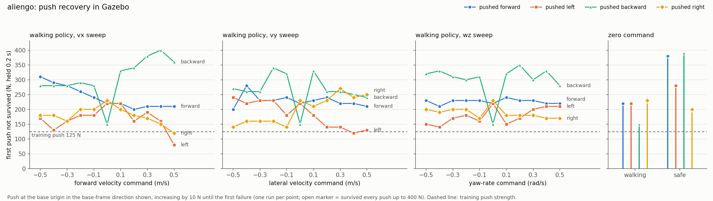
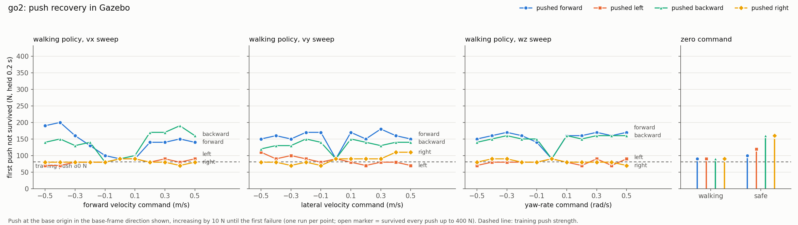

# RL quadruped controller

Runs the single-network velocity policy trained in `safe_rl` (`tasks/manager_based/velocity`) on a
locosim quadruped, in Gazebo or on the robot, behind a state machine for calibration, standing up,
walking, standing down and emergency collapse. The network estimates the base velocity internally,
so no state estimator is needed.

| `--robot` | policies (`safe_rl`, branch `feat/pace-actuators`) |
|---|---|
| `aliengo` | `Rl-Velocity-Aliengo` (walking), `Safe-Rl-Aliengo` (safe stop) |
| `go2` | `Rl-Velocity-Go2` (walking), `Safe-Rl-Go2` (safe stop) |

Both are trained on the identified PACE actuator model (joint friction and reflected rotor inertia),
which the Gazebo descriptions also carry.

## Files

| File | Role |
|---|---|
| `rl_quadruped_controller.py` | controller, state machine, CLI |
| `rl_controller_config.py` | the only configuration the controller reads (`params.py` is not used) |
| `velocity_policy.py` | ONNX wrapper: observation history, decimation, velocity-estimation head |
| `commandInterface.py` | keyboard and Xbox pad input |
| `run_rl_controller.sh` | launcher with real-time priority and optional core pinning |
| `run_sim.py`, `gait_report.py` | scripted Gazebo run and its gait report |
| `push_sweep.py` | push-recovery sweep in Gazebo |
| `policies/<robot>_velocity.json` | deployment contract shared by both networks |
| `policies/<robot>_velocity_{normal,safe}.onnx` | walking policy and zero-command safe-stop policy |

`components/rl_velocity_controller/rl_controller.py` (used by `quadruped_controller.py`) runs the
same policies through `VelocityPolicy`.

## Running

Inside the container:

```bash
cd $LOCOSIM_DIR/robot_control/base_controllers/rl_quadruped

python3 rl_quadruped_controller.py --robot go2                # Gazebo, keyboard
python3 rl_quadruped_controller.py --robot go2 --input joy    # Gazebo, Xbox pad
./run_rl_controller.sh --robot go2 --real --input joy         # real robot
```

| Argument | Default | Effect |
|---|---|---|
| `--robot NAME` | `aliengo` | a robot in `ROBOTS` (`rl_controller_config.py`) |
| `--input {keyboard,joy,none}` | `keyboard` | `joy` starts `joy_node` and reads `/joy`; `none` takes no input |
| `--real` | off | real robot: checks the NIC, pings the robot, clips commands to 90 % of the joint limits, real-time tuning on |
| `--network-interface NAME` | config | NIC the Go2 driver binds to |
| `--skip-calibration` | off | leave the accelerometer bias at zero |
| `--world NAME` | `rl_flat.world` | Gazebo world |
| `--gui` | off | Gazebo GUI |
| `--no-rviz` | rviz on | do not start rviz |
| `--no-telemetry` | on | do not publish the telemetry topics |
| `--bag [PREFIX]` | off | record joint and telemetry topics, default name `rl_<robot>` |
| `--realtime` / `--no-realtime` | only with `--real` | SCHED_FIFO for all threads and GC tuning |

`run_rl_controller.sh` starts the process with `chrt -f 80` so start-up is real-time too; `CPU=3`
also pins it with `taskset` (useful only on a core isolated with
`isolcpus=3 nohz_full=3 rcu_nocbs=3 irqaffinity=0-2`), `PRIO=90` changes the priority.

## Operator controls

| Action | Keyboard | Xbox pad |
|---|---|---|
| Calibrate IMU bias | `c` | Y |
| Stand up | `u` | A |
| Start the RL policy | `r` | X |
| **Safe stop** (stay standing) | `f` | RB |
| Stand down | `d` | B |
| **Emergency damping** | `SPACE` | BACK, or LB+RB |
| Quit (damping first) | `q` | START |
| Forward / backward | `w` / `s` | left stick Y |
| Left / right | `a` / `z` | left stick X |
| Turn | `j` / `l` | right stick X |
| Exact velocity | `v` then `vx[,vy[,wz]]` Enter | |
| Forward presets | `1`...`5` | |
| Zero the command | `x` | release the sticks |
| One push / a burst / force -+ *(Gazebo)* | `p` / `P` / `-` `+` | |

Keyboard commands are held between key presses and clamped to `max_lin_vel_cmd` /
`max_ang_vel_cmd` (0.5, the training range). `SPACE` triggers the emergency even while a velocity is
being typed, which is why the entry uses commas. The default push is the strongest push used in
training (`body_mass` x 1 m/s over 0.2 s: 125 N Aliengo, 80 N Go2).

## State machine

```
INIT ──▶ CALIBRATE ──▶ FOLD ──▶ STAND_UP ──▶ STANDING
                         ▲                          │
                         │                          ▼
                         └── STAND_DOWN ◀───── RL ⇄ SAFE_STOP

any state ──[emergency]──▶ DAMPING ──▶ DONE
```

| State | Gains | Behaviour |
|---|---|---|
| `INIT` | fold | hold the measured posture for `settle_duration` |
| `CALIBRATE` | fold | accelerometer bias, see below |
| `FOLD` | fold | quintic move to `q_fold`, then hold it and wait for a stand-up |
| `STAND_UP` | stand | quintic through `q_fold` to the policy's `q_default` |
| `STANDING` | stand | hold `q_default`, safety checks on |
| `RL` | policy | walking policy on the operator command |
| `SAFE_STOP` | policy | `safe` variant at zero command |
| `STAND_DOWN` | stand | quintic to `q_fold`, back to `FOLD` |
| `DAMPING` | kp = 0, `kd_damping` | the robot sinks under its weight, feed-forward ramped out |
| `DONE` | zero | joints released, the loop ends |

**Calibration.** The bias is observable only while the base does not accelerate, so it runs before
any commanded motion with the robot lying flat and still. It waits `calib_stable_window` s of
continuous stillness (gyro and joint-rate thresholds), averages `calibration_duration` s, and starts
over on any motion. The bias is rejected if implausible (> 2 m/s^2), redone if the samples spread,
and kept with a warning if `|acc - bias| - |g|` is large. After `calib_wait_timeout` s without
stillness it goes on with a zero bias. `c` / Y re-runs it from the fold.

**Policy states.** Entering `RL` or `SAFE_STOP` from a non-policy state seeds the observation history
from the current measurement (as an Isaac Lab reset). Switching between the two keeps the history,
so the hand-over works mid-stride. Every entry zeroes the stored command. Both states leave to
`DAMPING` when roll or pitch exceed `max_roll_pitch` or a joint exceeds `max_joint_vel`.

## Policy contract

`policies/<robot>_velocity.json` holds what both networks share: `onnx_variants`, `obs_dim`,
`num_actions`, `history_length`, `policy_rate` (50 Hz), `action_scale` (0.5), `q_default`, `kp`,
`kd` and `obs_layout`. The observation is 228 floats:

```
[  0:  3)  velocity_commands       (vx, vy, wz)   current step only
[  3: 18)  imu_lin_acc             3 x 5          accelerometer, mean over the policy step
[ 18: 33)  imu_ang_vel             3 x 5
[ 33: 48)  imu_projected_gravity   3 x 5          (0, 0, -1) when level
[ 48:108)  joint_pos_rel          12 x 5          q - q_default
[108:168)  joint_vel_rel          12 x 5
[168:228)  actions                12 x 5          raw network outputs
```

* History blocks are oldest frame first; the normalizer is inside the ONNX graph.
* `q_des = q_default + action_scale * action`. The joint order is the policy's own and matches
  `joint_names` (lf, lh, rf, rh x haa, hfe, kfe), so no permutation.
* `imu_lin_acc` is the specific force (gravity included, bias removed) averaged over the 10 control
  ticks of a policy step, matching `ImuCfg.finite_difference = control_step` in training. The
  controller averages the samples within each tick, the policy averages the ticks, so the driver
  must publish the accelerometer every cycle.
* The policy runs every 10th tick of the 500 Hz loop and its target is held in between.
* The actor's velocity-estimation head is not a graph output; `VelocityPolicy` evaluates it from the
  weights in the same file and publishes it as `estimated_base_lin_vel`. If it disagrees with the
  real motion, the policy is acting on a wrong belief about its own velocity.

To deploy a new export, copy the two networks to `<robot>_velocity_normal.onnx` and
`<robot>_velocity_safe.onnx` and update the json if anything above changed (gains, action scale,
layout). The widths of both networks are checked against the json at load time.

## Joint controller

`ros_impedance_controller` applies `tau = kp (q_des - q) + kd (qd_des - qd) + tau_ffwd` every 2 ms,
in Gazebo and on the robot (torque mode). The controller always sets `ki = 0`, so this is the PD
actuator of training, and in the policy states it uses the json's `kp`/`kd` (Aliengo 25/2.0, Go2
20/1.5). The discrete PID branch of `ros_impedance_controller` (`/pid_discrete_implementation`) is a
different law; the controller warns if it is on.

In Gazebo the descriptions carry the PACE joint friction and rotor inertia (`const.xacro`, the rotor
inertia through `libjoint_armature_plugin`). `BaseController.startSimulator` adds locosim's
`gazebo_plugins/lib` to `GAZEBO_PLUGIN_PATH` so Gazebo finds the plugin, for every controller.

## Configuration

`get_config()` merges `DEFAULTS` with `ROBOTS[robot]`, refuses unknown keys and missing required
ones, and hands the result to `BaseController` as its `robot_params`. Per robot:

| Key | |
|---|---|
| `joint_names`, `ee_frames` | in the policy's joint order |
| `ip`, `network_interface` | real robot |
| `body_mass`, `foot_radius` | default push, spawn height |
| `spawn_posture_source`, `spawn_posture_name` | where `go0` takes the start-up posture: `srdf` (`home`, Aliengo) or `yaml` (`standDown` from `ros_impedance_controller.yaml`, Go2). The spawn height is computed from it so the robot does not drop at start-up |
| `q_fold` | resting posture, keep the knees off the hard stop |
| `kp_fold`, `kd_fold`, `kp_stand`, `kd_stand`, `kd_damping` | per-joint gains, the same in Gazebo and on the robot |
| `max_roll_pitch`, `max_joint_vel` | safety limits |

The other keys (timing, calibration thresholds, pushes, input) are shared in `DEFAULTS`.

**Adding a robot**: an entry in `ROBOTS`, the policy files under `policies/`, a
`<robot>_description` package (URDF, SRDF, `config/ros_impedance_controller.yaml`, `go0`) and, for
`--real`, a `<robot>_hardware_interface` publishing `/<robot>/joint_states`, `/<robot>/imu`
(orientation and rate) and `/<robot>/trunk_imu` (accelerometer). The launch is the generic
`ros_impedance_controller_floating.launch`.

## Real robot

* The Go2 driver (unitree_sdk2 DDS) binds to a named NIC: `network_interface` in the config (or
  `--network-interface`) must match the control PC. The controller checks that it exists, since a
  wrong name makes the driver wait for a lowstate forever.
* Keep the robot flat and still during calibration and check the residual it reports.
* Keep the emergency at hand: `BACK` / `LB+RB`, or `SPACE`.
* Once the joints are loaded, the controller prints one actuation check: commanded feedback torque
  against the motors' `tau_est`, to tell a communication fault from gains too low for the friction.
* At shutdown it prints the worst compute time per tick and the loop overruns.

## Telemetry

Published under `/<robot>/rl/` (joint data is already on `/command` and `/<robot>/joint_states`):

| Topic | Rate | Content |
|---|---|---|
| `state`, `policy_variant` | on change, latched | state machine state, active network |
| `velocity_command`, `action` | 50 Hz | command fed to the policy, raw action |
| `estimated_base_lin_vel` | 50 Hz | the actor's own velocity estimate, base frame |
| `policy/imu_lin_acc` | 50 Hz | the `imu_lin_acc` term the network got |
| `imu_lin_acc`, `projected_gravity`, `ang_vel_b`, `base_rpy` | 100 Hz | IMU terms, bias removed |
| `loop/dt_mean_ms`, `loop/dt_max_ms`, `loop/overruns` | 10 Hz | loop period |
| `loop/compute_mean_ms`, `loop/compute_max_ms` | 10 Hz | computation per tick (2 ms budget) |
| `policy/inferences` | 10 Hz | inference count |
| `push` | per push, latched | applied force, world frame (Gazebo) |

The controller also broadcasts `world -> base_link` for rviz: ground-truth position in Gazebo,
origin with the measured attitude on the robot.

## Tools

**Scripted run and gait report.** `run_sim.py` drives the controller in Gazebo through fixed phases
(settle, forward 0.3, yaw 0.5, lateral 0.3, forward 0.5, then the safe stop) and prints velocity,
height, attitude and torque per phase. `gait_report.py` prints the sections of safe_rl's
`scripts/rsl_rl/eval_gait.py` from the recording, to compare with an Isaac rollout.

```bash
python3 run_sim.py --robot go2 --record go2.npz
python3 gait_report.py go2.npz --phase fwd0.3
```

**Push sweep.** The first push (10 to 400 N in 10 N steps, 0.2 s) the robot does not survive, for
the walking policy at zero command and on one-axis sweeps of vx, vy, wz from -0.5 to 0.5, and the
safe policy at zero command, each pushed forward, left, backward and right. Every pair is its own
Gazebo run; from the host they run in parallel containers. The protocol is in the script's
docstring and copied into every result, and `manifest.json` records the policy md5s and the
robot_control commit and diff.

```bash
# on the host, from this directory (python3 with numpy, and matplotlib for plot)
python3 push_sweep.py sweep --robot go2 --out-dir ~/trento_lab_home/push_sweep/go2 \
    --docker mfocchi/trento_lab_framework:locosim --jobs 6
python3 push_sweep.py plot ~/trento_lab_home/push_sweep/go2
cp ~/trento_lab_home/push_sweep/go2/push_sweep.{png,csv} push_sweep_results/   # rename to go2.*
# one pair, inside the container
python3 push_sweep.py trial --robot go2 --cmd 0.3 0 0 --direction left --out r.json
```

A sweep is 128 Gazebo runs, about 40 min at `--jobs 6` on a 24-thread PC. Rerunning the same
command resumes it; `--repeats N` runs every point N times and plots the median and min-max.

### Push-recovery results

`push_sweep_results/` holds the figure and table of each robot, from 2026-10-26: robot_control
`c2bbe39`, go2_description `c60362a`, aliengo_description `881565f`, image
`mfocchi/trento_lab_framework:locosim` (`sha256:74200c4ab13e`), one run per point. All 256 runs
kept real time and every failure is a fall (tilt or height) or no recovery.

First push not survived. Walking: median over the 31 commands (lowest in brackets). Safe: zero
command. Training pushes are velocity kicks up to 1 m/s, i.e. 125 N on the Aliengo and 80 N on the
Go2 for 0.2 s.

| | forward | left | backward | right |
|---|---|---|---|---|
| Aliengo, walking | 230 N (200) | 170 N (80) | 300 N (150) | 180 N (120) |
| Aliengo, safe | 380 N | 280 N | 390 N | 200 N |
| Go2, walking | 160 N (90) | 80 N (70) | 150 N (80) | 80 N (70) |
| Go2, safe | 100 N | 120 N | 160 N | 160 N |




* **Aliengo** recovers well beyond training: as a velocity kick (F x 0.2 s / mass) the medians are
  1.4 m/s sideways, 1.8 m/s forward and 2.4 m/s backward. Sideways is the weak direction and it
  gets weaker with speed: walking forward at 0.5 m/s it falls at 80 N pushed left (0.6 m/s). A push
  along the motion is worse than against it (vy +0.5: 130 N pushed left, 250 N pushed right).
* **Go2** has no sideways margin: it falls at 70-110 N (median 80 N, 1.0 m/s), at or below 90 N in
  58 of 62 sideways points, i.e. at the training kick. Forward and backward it takes 1.0-2.5 m/s;
  at zero command the walking policy falls at 90 N in every direction.
* **Safe policy**: on the Aliengo it holds about 3 m/s forward and backward at zero command, against
  1.2-1.8 m/s for the walking policy; on the Go2 only 1.2-2.0 m/s.
* **Spread**: the earlier Aliengo sweep (three runs per point, previous joint model) gave the same
  walking medians within 10 N. Single points vary between runs by 2 force steps (20 N) at the
  median and 5 or more on one in ten points, so read the trends, not individual points.
* For more sideways margin on the Go2, the likely route is stronger lateral pushes in training, for
  both tasks.
