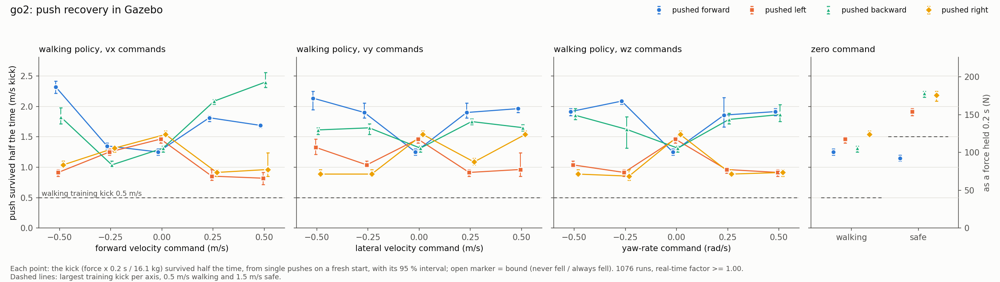
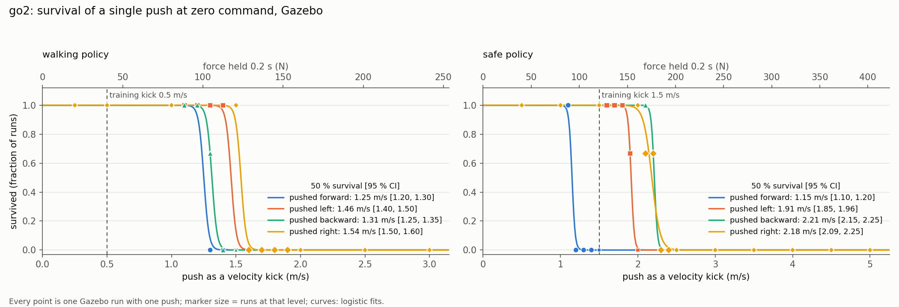
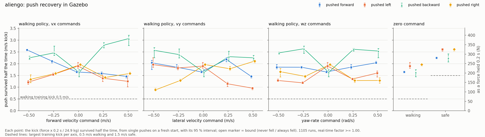
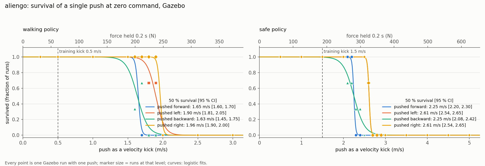

# RL quadruped controller

Runs the single-network velocity policy trained in `safe_rl` (`tasks/manager_based/velocity`) on a
locosim quadruped, in Gazebo or on the robot, behind a state machine for calibration, standing up,
walking, standing down and emergency collapse. The network estimates the base velocity internally,
so no state estimator is needed.

| `--robot` | policies (`safe_rl`, branch `feat/pace-actuators`) |
|---|---|
| `aliengo` | `Rl-Velocity-Aliengo` (walking), `Safe-Rl-Aliengo` (safe stop) |
| `go2` | `Rl-Velocity-Go2` (walking), `Safe-Rl-Go2` (safe stop) |

Both are trained on the identified PACE actuator model (joint friction and reflected rotor inertia),
which the Gazebo descriptions also carry.

## Files

| File | Role |
|---|---|
| `rl_quadruped_controller.py` | controller, state machine, CLI |
| `rl_controller_config.py` | the only configuration the controller reads (`params.py` is not used) |
| `velocity_policy.py` | ONNX wrapper: observation history, decimation, velocity-estimation head |
| `commandInterface.py` | keyboard and Xbox pad input |
| `run_rl_controller.sh` | launcher with real-time priority and optional core pinning |
| `run_sim.py`, `gait_report.py` | scripted Gazebo run and its gait report |
| `push_sweep.py` | push-recovery sweep in Gazebo |
| `policies/<robot>_velocity.json` | deployment contract shared by both networks |
| `policies/<robot>_velocity_{normal,safe}.onnx` | walking policy and zero-command safe-stop policy |

`components/rl_velocity_controller/rl_controller.py` (used by `quadruped_controller.py`) runs the
same policies through `VelocityPolicy`.

## Running

Inside the container:

```bash
cd $LOCOSIM_DIR/robot_control/base_controllers/rl_quadruped

python3 rl_quadruped_controller.py --robot go2                # Gazebo, keyboard
python3 rl_quadruped_controller.py --robot go2 --input joy    # Gazebo, Xbox pad
./run_rl_controller.sh --robot go2 --real --input joy         # real robot
```

| Argument | Default | Effect |
|---|---|---|
| `--robot NAME` | `aliengo` | a robot in `ROBOTS` (`rl_controller_config.py`) |
| `--input {keyboard,joy,none}` | `keyboard` | `joy` starts `joy_node` and reads `/joy`; `none` takes no input |
| `--real` | off | real robot: checks the NIC, pings the robot, clips commands to 90 % of the joint limits, real-time tuning on |
| `--network-interface NAME` | config | NIC the Go2 driver binds to |
| `--skip-calibration` | off | leave the accelerometer bias at zero |
| `--world NAME` | `rl_flat.world` | Gazebo world |
| `--gui` | off | Gazebo GUI |
| `--no-rviz` | rviz on | do not start rviz |
| `--no-telemetry` | on | do not publish the telemetry topics |
| `--bag [PREFIX]` | off | record joint and telemetry topics, default name `rl_<robot>` |
| `--realtime` / `--no-realtime` | only with `--real` | SCHED_FIFO for all threads and GC tuning |

`run_rl_controller.sh` starts the process with `chrt -f 80` so start-up is real-time too; `CPU=3`
also pins it with `taskset` (useful only on a core isolated with
`isolcpus=3 nohz_full=3 rcu_nocbs=3 irqaffinity=0-2`), `PRIO=90` changes the priority.

## Operator controls

| Action | Keyboard | Xbox pad |
|---|---|---|
| Calibrate IMU bias | `c` | Y |
| Stand up | `u` | A |
| Start the RL policy | `r` | X |
| **Safe stop** (stay standing) | `f` | RB |
| Stand down | `d` | B |
| **Emergency damping** | `SPACE` | BACK, or LB+RB |
| Quit (damping first) | `q` | START |
| Forward / backward | `w` / `s` | left stick Y |
| Left / right | `a` / `z` | left stick X |
| Turn | `j` / `l` | right stick X |
| Exact velocity | `v` then `vx[,vy[,wz]]` Enter | |
| Forward presets | `1`...`5` | |
| Zero the command | `x` | release the sticks |
| One push / a burst / force -+ *(Gazebo)* | `p` / `P` / `-` `+` | |

Keyboard commands are held between key presses and clamped to `max_lin_vel_cmd` /
`max_ang_vel_cmd` (0.5, the training range). `SPACE` triggers the emergency even while a velocity is
being typed, which is why the entry uses commas. The default push is a 1 m/s kick (`body_mass` x
1 m/s over 0.2 s: 125 N Aliengo, 80 N Go2), twice the walking task's largest training kick and two
thirds of the safe task's.

## State machine

```
INIT ──▶ CALIBRATE ──▶ FOLD ──▶ STAND_UP ──▶ STANDING
                         ▲                          │
                         │                          ▼
                         └── STAND_DOWN ◀───── RL ⇄ SAFE_STOP

any state ──[emergency]──▶ DAMPING ──▶ DONE
```

| State | Gains | Behaviour |
|---|---|---|
| `INIT` | fold | hold the measured posture for `settle_duration` |
| `CALIBRATE` | fold | accelerometer bias, see below |
| `FOLD` | fold | quintic from the lying posture to the crouch `q_fold`, haa keeping the stance; then hold it and wait for a stand-up |
| `STAND_UP` | stand | quintic from `q_fold` to the policy's `q_default` |
| `STANDING` | stand | hold `q_default`, safety checks on |
| `RL` | policy | walking policy on the operator command |
| `SAFE_STOP` | policy | `safe` variant at zero command |
| `STAND_DOWN` | stand | quintic to `q_fold`, back to `FOLD` |
| `DAMPING` | kp = 0, `kd_damping` | the robot sinks under its weight, feed-forward ramped out |
| `DONE` | zero | joints released, the loop ends |

**Calibration.** The bias is observable only while the base does not accelerate, so it runs before
any commanded motion with the robot lying flat and still. It waits `calib_stable_window` s of
continuous stillness (gyro and joint-rate thresholds), averages `calibration_duration` s, and starts
over on any motion. The bias is rejected if implausible (> 2 m/s^2), redone if the samples spread,
and kept with a warning if `|acc - bias| - |g|` is large. After `calib_wait_timeout` s without
stillness it goes on with a zero bias. `c` / Y re-runs it from the fold.

**Getting up.** The robot starts on its belly with the legs folded and splayed, feet just off the
ground, as the real robot rests (Gazebo spawns it in the description's `lieDown` posture, at the
height of its lowest collision point). It calibrates there with no feed-forward: the belly carries
the weight and nothing pushes on the ground. The fold lifts the body into `q_fold` (hfe = -kfe / 2
as in `q_default`) while a feed-forward of the robot's weight (gravity of the posture, minimum-norm
foot forces) ramps in, kept through `STAND_UP`, `STANDING` and `STAND_DOWN`; the PD only corrects,
so moderate gains (kp 25-50) reach the targets. Off the belly the feet carry the weight before they
are under the hips, and friction holds them where they land: dragging them in would take 40-60 % of
the haa limit. So from the fold on, haa keeps each foot at the lateral position it had lying (the
stance, counting the foot sphere rolling as the leg tilts) while hfe and kfe follow `q_fold` and
`q_default`. The robot stands with haa about 0.15 rad wider than `q_default` (Go2 0.13-0.17,
Aliengo 0.17-0.18), the rest within 0.03 rad, and the policy narrows the stance as it walks.
`STAND_DOWN` measures the stance again.

**Policy states.** Entering `RL` or `SAFE_STOP` from a non-policy state seeds the observation history
from the current measurement (as an Isaac Lab reset). Switching between the two keeps the history,
so the hand-over works mid-stride. Every entry zeroes the stored command. Both states leave to
`DAMPING` when roll or pitch exceed `max_roll_pitch` or a joint exceeds `max_joint_vel`.

## Policy contract

`policies/<robot>_velocity.json` holds what both networks share: `onnx_variants`, `obs_dim`,
`num_actions`, `history_length`, `policy_rate` (50 Hz), `action_scale` (0.5), `q_default`, `kp`,
`kd` and `obs_layout`. The observation is 228 floats:

```
[  0:  3)  velocity_commands       (vx, vy, wz)   current step only
[  3: 18)  imu_lin_acc             3 x 5          accelerometer, mean over the policy step
[ 18: 33)  imu_ang_vel             3 x 5
[ 33: 48)  imu_projected_gravity   3 x 5          (0, 0, -1) when level
[ 48:108)  joint_pos_rel          12 x 5          q - q_default
[108:168)  joint_vel_rel          12 x 5
[168:228)  actions                12 x 5          raw network outputs
```

* History blocks are oldest frame first; the normalizer is inside the ONNX graph.
* `q_des = q_default + action_scale * action`. The joint order is the policy's own and matches
  `joint_names` (lf, lh, rf, rh x haa, hfe, kfe), so no permutation.
* `imu_lin_acc` is the specific force (gravity included, bias removed) averaged over the 10 control
  ticks of a policy step, matching `ImuCfg.finite_difference = control_step` in training. The
  controller averages the samples within each tick, the policy averages the ticks, so the driver
  must publish the accelerometer every cycle.
* The policy runs every 10th tick of the 500 Hz loop and its target is held in between.
* The actor's velocity-estimation head is not a graph output; `VelocityPolicy` evaluates it from the
  weights in the same file and publishes it as `estimated_base_lin_vel`. If it disagrees with the
  real motion, the policy is acting on a wrong belief about its own velocity.

To deploy a new export, copy the two networks to `<robot>_velocity_normal.onnx` and
`<robot>_velocity_safe.onnx` and update the json if anything above changed (gains, action scale,
layout). The widths of both networks are checked against the json at load time.

## Joint controller

`ros_impedance_controller` applies `tau = kp (q_des - q) + kd (qd_des - qd) + tau_ffwd` every 2 ms,
in Gazebo and on the robot (torque mode). The controller always sets `ki = 0`, so this is the PD
actuator of training, and in the policy states it uses the json's `kp`/`kd` (Aliengo 25/2.0, Go2
20/1.5). The discrete PID branch of `ros_impedance_controller` (`/pid_discrete_implementation`) is a
different law; the controller warns if it is on.

In Gazebo the descriptions carry the PACE joint friction and rotor inertia (`const.xacro`, the rotor
inertia through `libjoint_armature_plugin`). `BaseController.startSimulator` adds locosim's
`gazebo_plugins/lib` to `GAZEBO_PLUGIN_PATH` so Gazebo finds the plugin, for every controller.

## Configuration

`get_config()` merges `DEFAULTS` with `ROBOTS[robot]`, refuses unknown keys and missing required
ones, and hands the result to `BaseController` as its `robot_params`. Per robot:

| Key | |
|---|---|
| `joint_names`, `ee_frames` | in the policy's joint order |
| `ip`, `network_interface` | real robot |
| `body_mass`, `foot_radius` | default push; the foot sphere rolling in the stance |
| `spawn_posture_source`, `spawn_posture_name` | where `go0` takes the start-up posture: `srdf` (a group state, Aliengo) or `yaml` (a posture in `ros_impedance_controller.yaml`, Go2), `lieDown` for both. The spawn height is computed from it (lowest collision point) so the robot does not drop at start-up |
| `q_fold` | crouch on the feet, start of the stand-up; haa is replaced by the stance |
| `kp_fold`, `kd_fold`, `kp_stand`, `kd_stand`, `kd_damping` | per-joint gains, the same in Gazebo and on the robot |
| `max_roll_pitch`, `max_joint_vel` | safety limits |

The other keys (timing, calibration thresholds, pushes, input) are shared in `DEFAULTS`.

**Adding a robot**: an entry in `ROBOTS`, the policy files under `policies/`, a
`<robot>_description` package (URDF, SRDF, `config/ros_impedance_controller.yaml`, `go0`) and, for
`--real`, a `<robot>_hardware_interface` publishing `/<robot>/joint_states`, `/<robot>/imu`
(orientation and rate) and `/<robot>/trunk_imu` (accelerometer). The launch is the generic
`ros_impedance_controller_floating.launch`.

## Real robot

* The Go2 driver (unitree_sdk2 DDS) binds to a named NIC: `network_interface` in the config (or
  `--network-interface`) must match the control PC. The controller checks that it exists, since a
  wrong name makes the driver wait for a lowstate forever.
* Keep the robot flat and still during calibration and check the residual it reports.
* Keep the emergency at hand: `BACK` / `LB+RB`, or `SPACE`.
* Once the joints are loaded, the controller prints one actuation check: commanded feedback torque
  against the motors' `tau_est`, to tell a communication fault from gains too low for the friction.
* At shutdown it prints the worst compute time per tick and the loop overruns.

## Telemetry

Published under `/<robot>/rl/` (joint data is already on `/command` and `/<robot>/joint_states`):

| Topic | Rate | Content |
|---|---|---|
| `state`, `policy_variant` | on change, latched | state machine state, active network |
| `velocity_command`, `action` | 50 Hz | command fed to the policy, raw action |
| `estimated_base_lin_vel` | 50 Hz | the actor's own velocity estimate, base frame |
| `policy/imu_lin_acc` | 50 Hz | the `imu_lin_acc` term the network got |
| `imu_lin_acc`, `projected_gravity`, `ang_vel_b`, `base_rpy` | 100 Hz | IMU terms, bias removed |
| `loop/dt_mean_ms`, `loop/dt_max_ms`, `loop/overruns` | 10 Hz | loop period |
| `loop/compute_mean_ms`, `loop/compute_max_ms` | 10 Hz | computation per tick (2 ms budget) |
| `policy/inferences` | 10 Hz | inference count |
| `push` | per push, latched | applied force, world frame (Gazebo) |

The controller also broadcasts `world -> base_link` for rviz: ground-truth position in Gazebo,
origin with the measured attitude on the robot.

## Tools

**Scripted run and gait report.** `run_sim.py` drives the controller in Gazebo through fixed phases
(settle, forward 0.3, yaw 0.5, lateral 0.3, forward 0.5, then the safe stop) and prints velocity,
height, attitude and torque per phase. `gait_report.py` prints the sections of safe_rl's
`scripts/rsl_rl/eval_gait.py` from the recording, to compare with an Isaac rollout.

```bash
python3 run_sim.py --robot go2 --record go2.npz
python3 gait_report.py go2.npz --phase fwd0.3
```

**Push recovery.** `push_sweep.py` measures, per condition, the push the robot survives half the
time. A push of strength k (m/s) is a force of `body_mass` x k / 0.2 s held for 0.2 s on the base,
so k is the velocity kick it gives; training kicked the robot by up to 0.5 m/s per axis in the
walking task and 1.5 m/s in the safe one. Conditions: the walking policy at zero command and at
vx, vy or wz = +-0.25 and +-0.5, the safe policy at zero command, each pushed forward, left,
backward and right.

Every trial is a fresh Gazebo run with exactly one push, at a seeded random moment of the second
after a 4 s settle, so no trial depends on another. Per condition the sweep is adaptive: one run at
each coarse level, then three runs every 0.1 m/s inside the gap between the last level always
survived and the first never survived. `plot` fits a logistic survival curve per condition and
reports the 50 % point with a parametric-bootstrap 95 % interval, and the same point from two halves
of the runs as a repeatability check. The protocol is in the script's docstring and in every
result; `manifest.json` records the design, the policy md5s, the robot_control commit and diff, and
the image.

```bash
# on the host, from this directory (python3 with numpy, scipy and matplotlib)
python3 push_sweep.py sweep --robot go2 --out-dir ~/trento_lab_home/push_sweep/go2 \
    --docker mfocchi/trento_lab_framework:locosim --jobs 10
python3 push_sweep.py plot ~/trento_lab_home/push_sweep/go2
# push_sweep.png -> push_sweep_results/go2_sweep.png, push_survival.png -> go2_survival.png,
# push_sweep.csv -> go2.csv
# one push, inside the container
python3 push_sweep.py trial --robot go2 --cmd 0.3 0 0 --direction left --force 100 --out r.json
```

A sweep is about 1,100 runs per robot, 40 min at `--jobs 10` on a 24-thread PC. Rerunning the
same command resumes it, and `--command-steps` with other values adds commands to the same folder.

### Push-recovery results

From 2026-10-26: robot_control `596f8f2` with this `push_sweep.py`, go2_description `c60362a`,
aliengo_description `881565f`, image `mfocchi/trento_lab_framework:locosim`
(`sha256:74200c4ab13e`). 1,076 runs on the Go2 and 1,105 on the Aliengo, no errors, all in real
time. Figures and tables: `push_sweep_results/<robot>_sweep.png`, `<robot>_survival.png`,
`<robot>.csv`.

Push survived half the time at zero command, m/s [95 % interval]:

| | forward | left | backward | right |
|---|---|---|---|---|
| Go2, walking | 1.25 [1.20, 1.30] | 1.46 [1.40, 1.50] | 1.31 [1.25, 1.35] | 1.54 [1.50, 1.60] |
| Go2, safe | 1.15 [1.10, 1.20] | 1.91 [1.85, 1.96] | 2.21 [2.15, 2.25] | 2.18 [2.09, 2.25] |
| Aliengo, walking | 1.65 [1.60, 1.70] | 1.90 [1.81, 2.05] | 1.63 [1.45, 1.75] | 1.96 [1.90, 2.00] |
| Aliengo, safe | 2.25 [2.20, 2.30] | 2.61 [2.54, 2.65] | 2.25 [2.08, 2.42] | 2.61 [2.54, 2.65] |






* **Walking policy**: it survives at least 0.8 m/s in every condition, 1.6x its 0.5 m/s training
  kick (lowest: Go2 walking forward at 0.5 m/s pushed left, 0.82; Aliengo walking right at 0.5 m/s
  pushed right, 0.89).
* At zero command, sideways pushes are survived better than forward and backward ones on both
  robots (Go2 1.46-1.54 against 1.25-1.31 m/s, Aliengo 1.90-1.96 against 1.63-1.65).
* Walking reverses this: with any command, sideways becomes the weak direction (median Go2 0.91,
  Aliengo 1.37 m/s, against 1.85 and 2.25 forward and backward). A push against the motion is
  survived best (walking forward at 0.5 m/s pushed backward: Go2 2.40, Aliengo 3.07), a sideways
  push along a lateral motion worst (walking left at 0.5 m/s pushed left: 0.96 on both).
* **Safe policy**: better than the walking policy at zero command in every direction but one. The
  Aliengo holds 2.25-2.61 m/s, 1.5-1.7x its 1.5 m/s training kick, more sideways than forward and
  backward, and identically left and right push for push (the policies are trained with left-right
  symmetry). The Go2 holds 1.9-2.2 m/s except pushed forward: 1.15 m/s, below its training kick,
  with every forward push from 1.2 m/s up falling. That is the one clear weakness.
* **Repeatability**: the two halves of the runs give the same 50 % point within 0.05 m/s at the
  median (90 % of conditions within 0.12 on the Go2 and 0.15 on the Aliengo, largest 0.20 and
  0.37), and both halves fall inside the 95 % interval +-0.1 m/s in all 112 conditions. The median
  interval is 0.11 m/s (Go2) and 0.15 m/s (Aliengo). A wide interval means survival changes
  gradually with the push, because the outcome depends on where in the stride the push lands
  (e.g. Aliengo walking forward at 0.5 m/s, pushed left).
* The test push is a 0.2 s force at the base origin, while training changed the base velocity
  instantly and the safe task also kicked the vertical and angular velocities: compare trends and
  directions, not absolute margins.
